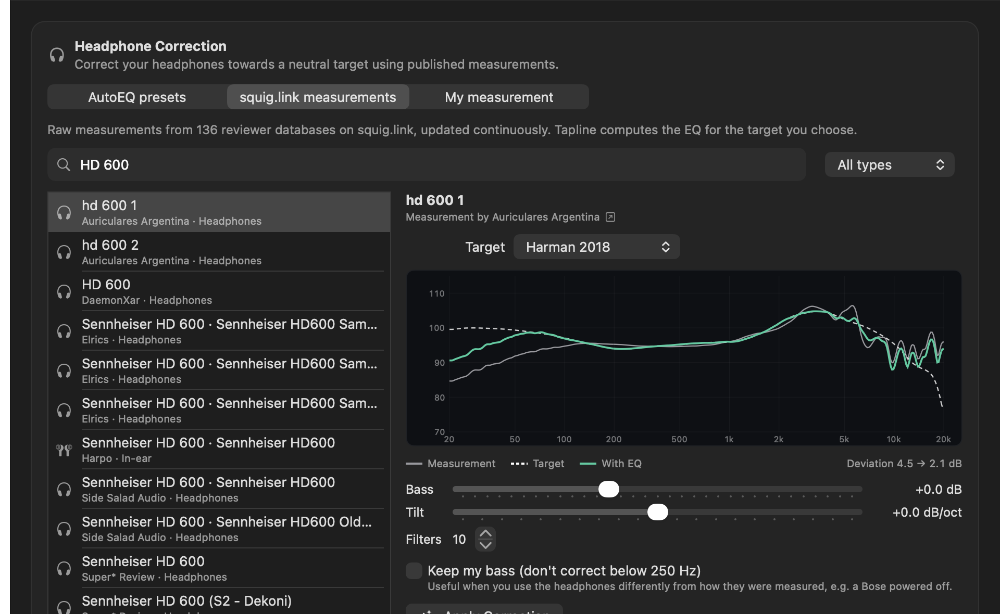

<p align="center">
  
</p>

<h1 align="center">Tapline</h1>

<p align="center">
  A system-wide parametric EQ, per-app mixer and headphone correction tool for macOS.<br>
  No audio driver to install. Built on Core Audio process taps.<br>
  <a href="#中文说明">中文说明</a>
</p>


## Features

**Equalizer**
- Up to 24 parametric bands: bell, low/high shelf, low/high pass, notch, band pass
- Drag bands directly on the graph, scroll or pinch to change Q, double-click to add, ⌥-click to delete, arrow keys to nudge
- Real-time FFT spectrum analyzer behind the curve (before and after the EQ), with display tilt
- Automatic preamp that cancels the largest boost so the EQ never clips
- A/B comparison, undo/redo, presets (optionally including effects, e.g. one setup for headphones and one for speakers)
- A separate EQ for every output device, switched automatically when you change outputs

**Headphone correction**
- **AutoEQ presets**: ready-made correction curves for 5,000+ headphones from the [AutoEQ](https://github.com/jaakkopasanen/AutoEq) project
- **squig.link measurements**: search 40,000+ raw measurements from 130+ reviewer databases on [squig.link](https://squig.link), pick one of the database's target curves, and Tapline fits the parametric EQ for you. New headphones show up as soon as a reviewer publishes them.
- **Your own measurement**: import a frequency response (REW, miniDSP EARS, CSV) and fit it to any target
- Bass and tilt preferences, filter count, and *Keep my bass* for headphones you use differently from how they were measured (e.g. passive / powered off)
- Live preview of measurement, target and result

**Assistant**
- Quick Tone: Bass, Warmth, Clarity and Air
- Sound Assistant: describe what you hear ("less boomy", "less sibilance", "clearer vocals") and Tapline makes a small, undoable change
- Import and export Equalizer APO / AutoEQ `ParametricEQ.txt` files

**Mixer**
- Volume (0–200%) and mute for each app, with live meters
- **Bypass** an app so it plays unprocessed, for example Logic Pro while you mix
- Helper processes are grouped under their app (Chrome, Safari, Electron apps…)

**Effects, devices and more**
- Look-ahead limiter, output gain, balance, stereo width, mono, L/R swap, headphone crossfeed
- Switch output/input devices and sample rates, control the system volume
- Menu bar panel, global shortcuts (⌃⌥⌘P on/off, ⌃⌥⌘B bypass EQ, ⌃⌥⌘K A/B)
- Recovers by itself after sleep or when the audio device resets
- Switches itself off if it detects a feedback loop (for example another tap-based tool re-capturing Tapline's output)
- English and Simplified Chinese



## Requirements

- macOS 26 Tahoe or later
- Apple Silicon (arm64 only)
- Xcode 26 or later and [XcodeGen](https://github.com/yonaskolb/XcodeGen) to build

## Install

Download the latest build from [Releases](https://github.com/belugaming/tapline/releases), unzip it and move **Tapline.app** to Applications. The app is not notarized yet, so the first time you open it, right-click it and choose **Open**.

## Build

```bash
brew install xcodegen
git clone https://github.com/belugaming/tapline.git
cd tapline
xcodegen generate
xcodebuild -project Tapline.xcodeproj -scheme Tapline -configuration Release -derivedDataPath build build
open build/Build/Products/Release/Tapline.app
```

The DSP core is a Swift package with its own tests:

```bash
cd Packages/TaplineCore && swift test
```

## First start

1. Quit SoundSource, eqMac or similar tools, otherwise two apps process the same audio.
2. Turn Tapline on with the power button and allow **System Audio Recording** when macOS asks. The permission is required to process other apps' audio.
3. Builds signed ad hoc (the default when you build it yourself) may ask for the permission again after every rebuild. Sign with your own Apple Development certificate to avoid that.

## How it works

```
apps ──► process taps (muted at the source while Tapline reads them)
     ──► private aggregate device = [taps + your output device]
     ──► C IOProc: mix apps → preamp → EQ → effects → limiter
     ──► output device's stereo channels
```

- One system-wide tap captures every app except Tapline itself, apps with their own mixer settings and apps playing to a different device. Each app with a custom volume gets its own tap.
- Taps and the real output device share one aggregate device, so capture and playback run in the same IO cycle on the same clock, without resampling. Hardware input streams are disabled for the IOProc, so no microphone access is involved.
- The realtime path is plain C (`Packages/TaplineCore/Sources/TaplineDSP`): no allocation, locks or Swift runtime on the audio thread. Parameters reach it through a lock-free triple buffer. Filters are RBJ biquads in double precision.
- The EQ fitter (`EQFitter.swift`) follows AutoEQ's approach: level-match, smooth the required correction (two-octave smoothing above 8 kHz, where measurement rigs disagree), then add shelves and bells greedily and refine all parameters with a pattern search.
- If Tapline quits or crashes, its private taps and aggregate device disappear with it and audio goes back to normal. Only one copy of Tapline runs at a time.

Added latency is roughly one IO buffer plus 1.5 ms of limiter look-ahead (about 12 ms at 48 kHz). See **Devices → Audio Engine** for the exact numbers.

## Privacy and network use

Audio is processed locally and never recorded or sent anywhere. Network requests are only made when you use headphone correction:

- AutoEQ: the index and profiles are downloaded from GitHub and cached for a week.
- squig.link: the site directory, each database's phone list, target curves and the measurements you open are downloaded from the reviewers' squig.link sites and cached. Sites on squig.link's own opt-out list are never contacted.

## Known limitations

- Apps that set exclusive (hog) mode on a device cannot be tapped.
- Apps routed to a non-default output device are left alone (no EQ) unless you give them their own mixer settings.
- The first time you change an app's volume, Tapline rebuilds its audio path, which causes a short gap.
- AirPods and other adaptive headphones change their own EQ with volume and fit, so any correction is approximate.

## Credits

- Headphone correction curves: [AutoEQ](https://github.com/jaakkopasanen/AutoEq) by Jaakko Pasanen and contributors (oratory1990, crinacle, Rtings, …)
- Frequency response measurements: the reviewers publishing on [squig.link](https://squig.link). The data belongs to them; please visit and support their sites.
- Filter designs: Robert Bristow-Johnson's *Audio EQ Cookbook*

## License

Tapline is free software: you can redistribute it and/or modify it under the terms of the [GNU General Public License v3.0](LICENSE) as published by the Free Software Foundation. It comes with no warranty.

If you distribute a modified version, it must also be released under GPL-3.0 with its source code.

---

## 中文说明

Tapline 是一个 macOS 全局参数均衡器、分应用混音器和耳机校正工具。不用安装音频驱动，基于系统的 Core Audio 进程截取接口实现。

### 功能

- **均衡器**：最多 24 个参数频段（峰值、低/高频搁架、低/高通、陷波、带通），直接在曲线图上拖动频点，滚轮或双指缩放调 Q 值，双击添加频段。曲线后面是实时频谱，可以同时显示 EQ 前后的频谱。支持自动预增益（防破音）、A/B 对比、撤销/重做和预设，预设可以连同效果设置一起保存，比如"耳机"和"音箱"各存一套。每个输出设备单独保存一套 EQ，切换设备时自动切换。
- **耳机校正**：
  - **AutoEQ 现成方案**：5000 多款耳机的现成校正曲线。
  - **squig.link 测量**：搜索 130 多个测评数据库里的 4 万多条原始测量，选一条目标曲线，Tapline 自动算出参数 EQ。新耳机只要有人上传测量就能用。
  - **自己的测量**：导入 REW、miniDSP EARS 或 CSV 格式的频响数据。
  - 可以调低音和倾斜偏好、滤波器数量；"保留低音"适合使用方式和测量时不同的耳机（比如关机使用的 Bose）。
- **辅助调音**：低音、温暖度、清晰度、空气感四个旋钮；"声音助手"按描述做小调整；导入导出 Equalizer APO / AutoEQ 格式。
- **混音器**：每个 App 单独调音量（0–200%）、静音，显示实时电平；可以把 App 设为**直通**，比如用 Logic 混音时让它不经过 EQ。
- **效果与其他**：限幅器、输出增益、声道平衡、立体声宽度、单声道、左右互换、耳机交叉馈送；切换输入输出设备和采样率；菜单栏面板；全局快捷键（⌃⌥⌘P 开关处理、⌃⌥⌘B 旁通 EQ、⌃⌥⌘K A/B 对比）；睡眠唤醒或设备重置后自动恢复；检测到反馈回路时自动关闭。

### 系统要求

macOS 26 或更高版本，Apple Silicon（只支持 arm64）。

### 安装

从 [Releases](https://github.com/belugaming/tapline/releases) 下载最新版本，解压后把 **Tapline.app** 拖进"应用程序"。目前没有经过 Apple 公证，第一次打开时请右键点它，选"打开"。

第一次使用时，先退出 SoundSource、eqMac 这类软件，再点电源按钮开启 Tapline，系统弹出"录制系统音频"权限时点允许。

### 隐私

所有声音都在本机处理，不会录音，也不会上传。只有在使用耳机校正时才会联网：从 GitHub 下载 AutoEQ 数据，或从 squig.link 测评站点下载频响数据，下载后会缓存。在 squig.link 退出名单里的站点不会被访问。

### 许可证

Tapline 以 [GNU 通用公共许可证 v3.0](LICENSE)（GPL-3.0）发布。你可以自由使用、修改和分发；如果分发修改后的版本，也必须以 GPL-3.0 开源并提供源代码。本软件不提供任何担保。
