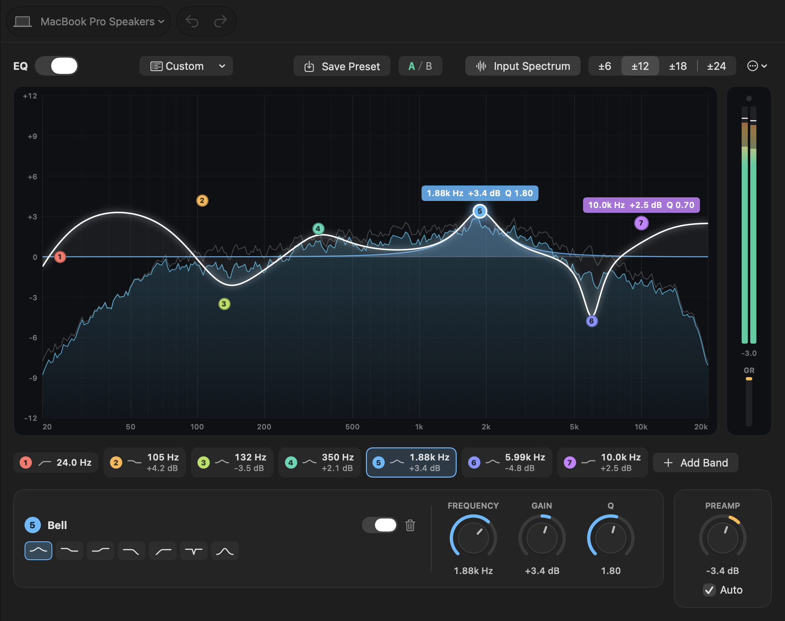
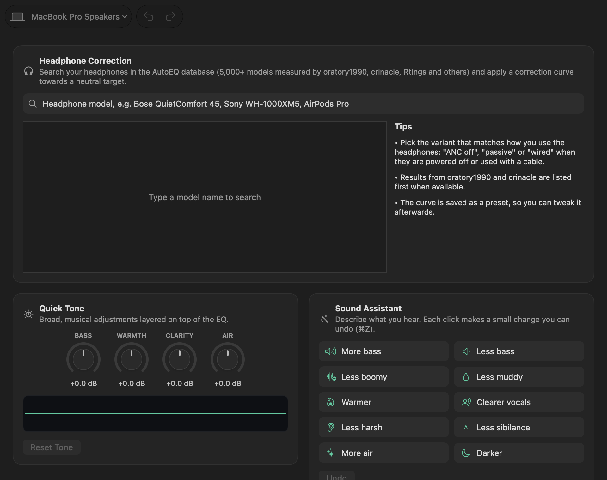

<p align="center">
  
</p>

<h1 align="center">Tapline</h1>

<p align="center">
  A system-wide parametric EQ, per-app mixer and headphone toolkit for macOS.<br>
  No audio driver to install. Built on Core Audio process taps.<br>
  <a href="#中文说明">中文说明</a>
</p>



## Features

**Equalizer**
- Up to 24 parametric bands: bell, low/high shelf, low/high pass, notch, band pass
- Drag bands directly on the graph, scroll or pinch to change Q, double-click to add, ⌥-click to delete, arrow keys to nudge
- Real-time FFT spectrum analyzer behind the curve (pre- and post-EQ), with display tilt
- Automatic preamp that cancels the largest boost so the EQ never clips
- A/B comparison, unlimited undo/redo, presets
- A separate EQ for every output device, switched automatically when you change outputs

**Assistant**
- **Headphone correction**: search the [AutoEQ](https://github.com/jaakkopasanen/AutoEq) database (5,000+ headphones) and apply a correction curve with one click
- **Quick Tone**: Bass, Warmth, Clarity and Air controls
- **Sound Assistant**: describe what you hear ("less boomy", "less sibilance", "clearer vocals") and Tapline makes a small, undoable change
- Import and export Equalizer APO / AutoEQ `ParametricEQ.txt` files

**Mixer**
- Volume (0–200%) and mute for each app, with live meters
- **Bypass** an app so it plays unprocessed, for example Logic Pro while you mix
- Helper processes are grouped under their app (Chrome, Safari, Electron apps…)

**Effects & devices**
- Look-ahead limiter, output gain, balance, stereo width, mono, L/R swap, headphone crossfeed
- Switch output and input devices and sample rates, control the system volume
- Menu bar panel for quick access



## Requirements

- macOS 26 Tahoe or later
- Apple Silicon (arm64 only)
- Xcode 26 or later and [XcodeGen](https://github.com/yonaskolb/XcodeGen) to build

## Build

```bash
brew install xcodegen
git clone https://github.com/belugaming/tapline.git
cd tapline
xcodegen generate
xcodebuild -project Tapline.xcodeproj -scheme Tapline -configuration Release -derivedDataPath build build
open build/Build/Products/Release/Tapline.app
```

The DSP core is a Swift package with its own tests:

```bash
cd Packages/TaplineCore && swift test
```

On first start, turn Tapline on and allow **System Audio Recording** when macOS asks. The permission is required to process other apps' audio. If you quit SoundSource, eqMac or similar tools first, they will not fight over the same audio.

## How it works

```
apps ──► process taps (muted at the source while Tapline reads them)
     ──► private aggregate device = [taps + your output device]
     ──► C IOProc: mix apps → preamp → EQ → effects → limiter
     ──► output device's stereo channels
```

- One system-wide tap captures every app except Tapline itself, apps with their own mixer settings and apps playing to a different device. Each app with a custom volume gets its own tap.
- Taps and the real output device share one aggregate device, so capture and playback run in the same IO cycle on the same clock. Hardware input streams are disabled for the IOProc, so no microphone access is involved.
- The realtime path is plain C (`Packages/TaplineCore/Sources/TaplineDSP`): no allocation, locks or Swift runtime on the audio thread. Parameters reach it through a lock-free triple buffer. Filters are RBJ biquads in double precision.
- If Tapline quits or crashes, the private taps and aggregate device disappear with it and audio goes back to normal.

Added latency is roughly one IO buffer plus 1.5 ms of limiter look-ahead (about 12 ms at 48 kHz). See **Devices → Audio Engine** for the exact numbers.

## Privacy

Audio is processed locally and never recorded or sent anywhere. The only network request is the optional download of the AutoEQ index and profiles from GitHub, which is cached for a week.

## Known limitations

- Apps that set exclusive (hog) mode on a device cannot be tapped.
- Apps routed to a non-default output device are left alone (no EQ) unless you give them their own mixer settings.
- The first time you change an app's volume, Tapline rebuilds its audio path, which causes a short gap.
- Builds signed ad hoc (the default) may ask for the System Audio Recording permission again after every rebuild. Sign with your own Apple Development certificate to avoid that.

## Credits

- Headphone measurements and correction curves: [AutoEQ](https://github.com/jaakkopasanen/AutoEq) by Jaakko Pasanen and contributors (oratory1990, crinacle, Rtings, …)
- Filter designs: Robert Bristow-Johnson's *Audio EQ Cookbook*

## License

Tapline is free software: you can redistribute it and/or modify it under the terms of the [GNU General Public License v3.0](LICENSE) as published by the Free Software Foundation. It comes with no warranty.

If you distribute a modified version, it must also be released under GPL-3.0 with its source code.

---

## 中文说明

Tapline 是一个 macOS 全局参数均衡器、分应用混音器和耳机调音工具。不用安装音频驱动，基于系统的 Core Audio 进程截取接口实现。

### 功能

- **均衡器**：最多 24 个参数频段（峰值、低/高频搁架、低/高通、陷波、带通）。直接在曲线图上拖动频点，滚轮或双指缩放调 Q 值，双击添加频段。曲线下面是实时频谱，可以同时显示 EQ 前后的频谱。支持自动预增益（防破音）、A/B 对比、撤销/重做和预设。每个输出设备单独保存一套 EQ，切换设备时自动切换。
- **辅助调音**：在 AutoEQ 数据库（5000 多款耳机）里搜索型号，一键套用校正曲线；低音、温暖度、清晰度、空气感四个旋钮；"声音助手"按描述做小调整（比如"低音不轰""减轻齿音""人声更清晰"）；可以导入导出 Equalizer APO / AutoEQ 的 `ParametricEQ.txt` 格式。
- **混音器**：每个 App 单独调音量（0–200%）、静音，显示实时电平；可以把 App 设为**直通**，比如用 Logic 混音时让它不经过 EQ。
- **效果与设备**：限幅器、输出增益、声道平衡、立体声宽度、单声道、左右互换、耳机交叉馈送；切换输入输出设备和采样率；菜单栏快捷面板。

### 系统要求

macOS 26 或更高版本，Apple Silicon（只支持 arm64）。

### 编译

按上面 [Build](#build) 一节的命令操作。第一次打开时，先开启 Tapline，系统弹出"录制系统音频"权限时点允许。使用 Tapline 时请先退出 SoundSource、eqMac 这类软件，避免同一路声音被重复处理。

### 隐私

所有声音都在本机处理，不会录音，也不会上传。唯一的网络请求是按需从 GitHub 下载 AutoEQ 的耳机列表和校正数据，下载后会缓存一周。

### 许可证

Tapline 以 [GNU 通用公共许可证 v3.0](LICENSE)（GPL-3.0）发布。你可以自由使用、修改和分发；如果分发修改后的版本，也必须以 GPL-3.0 开源并提供源代码。本软件不提供任何担保。
