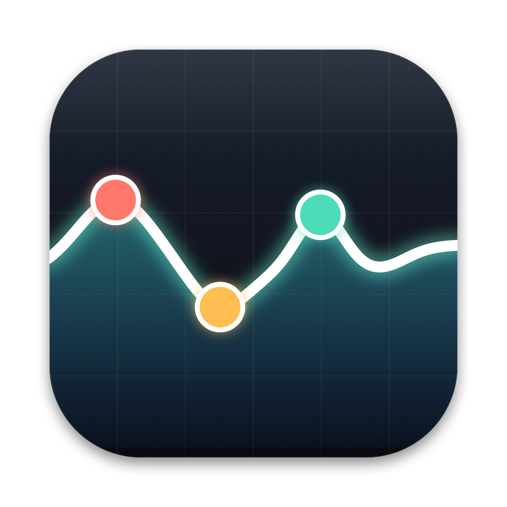
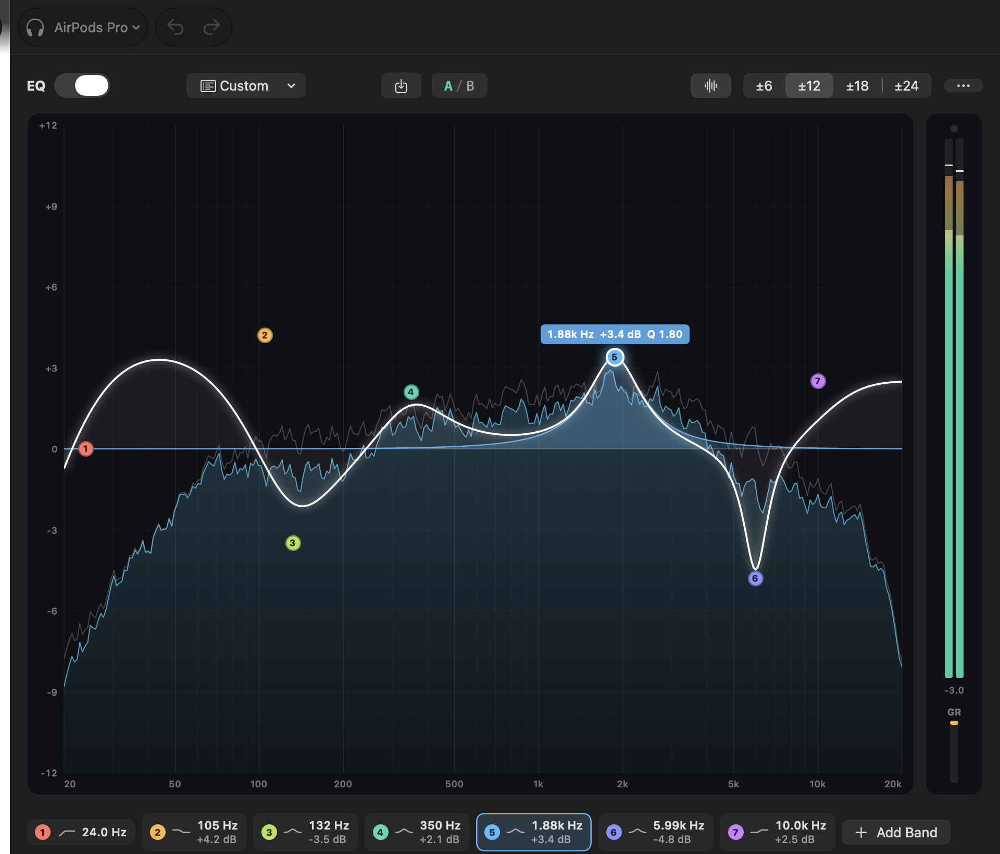
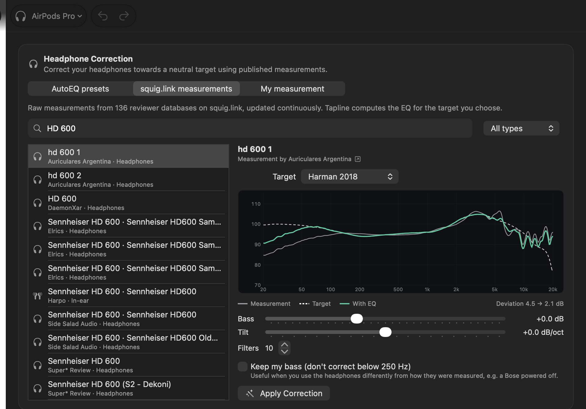
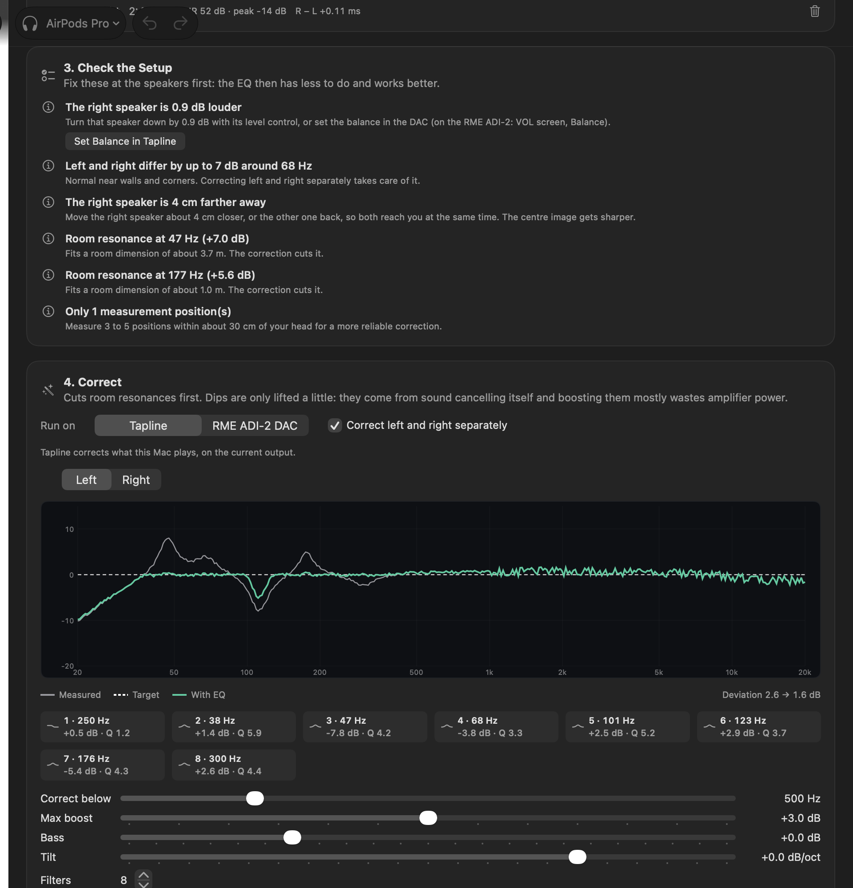
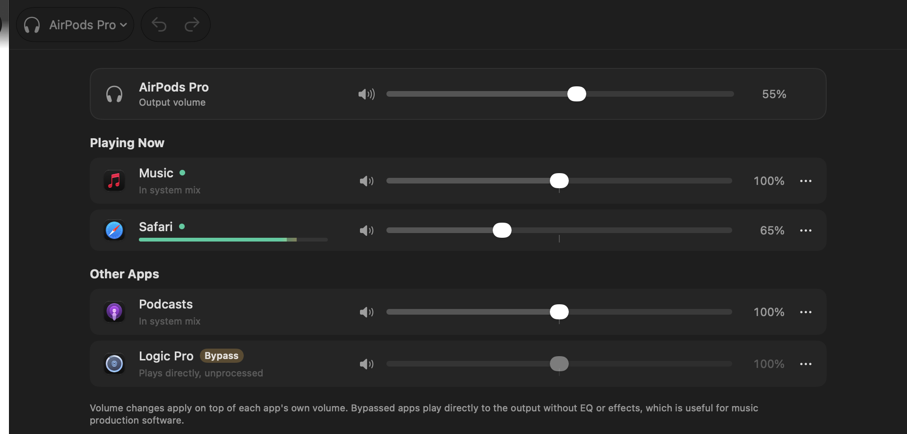
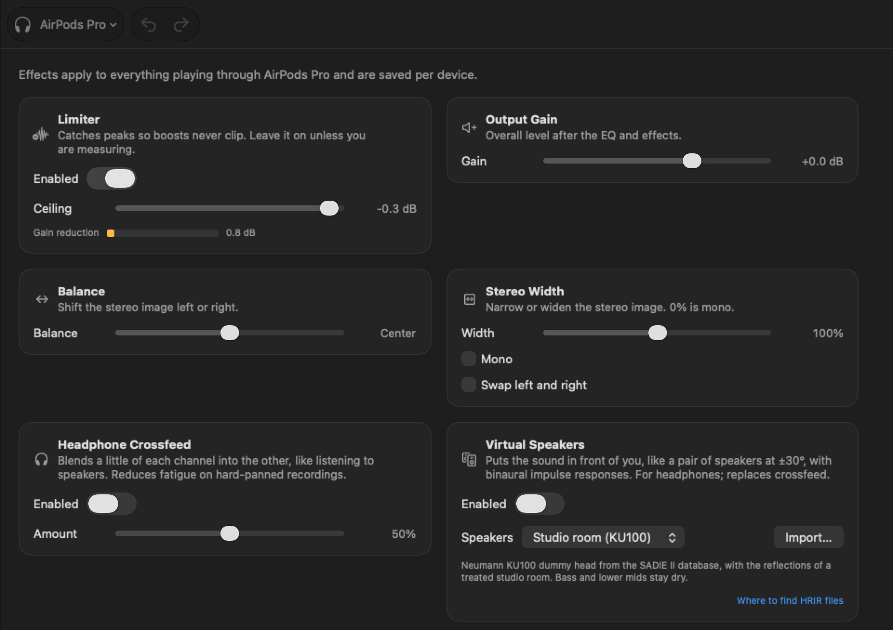
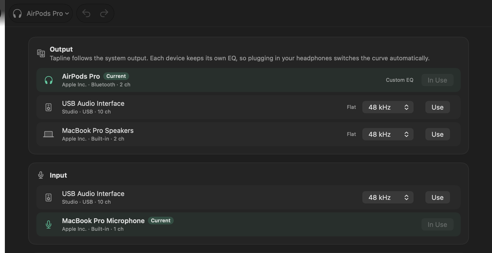
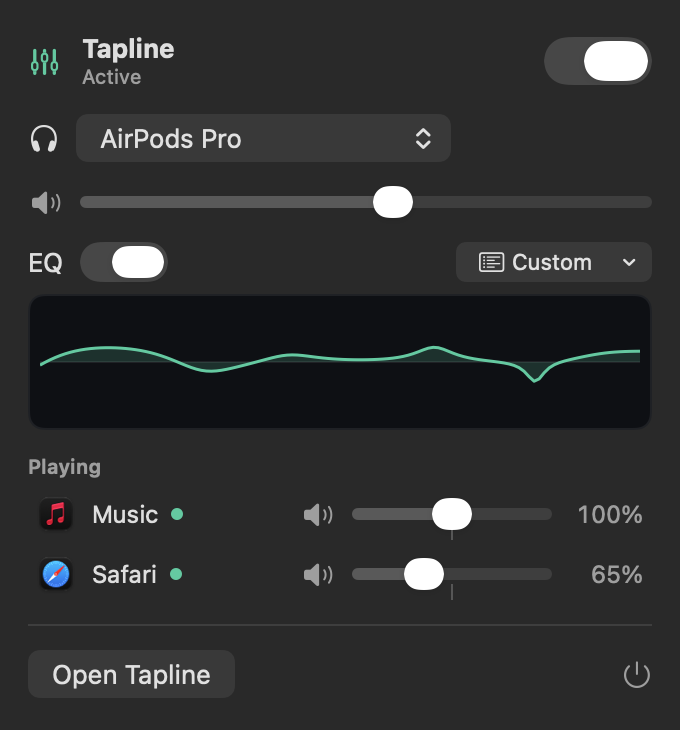

<p align="center">
  
</p>

<h1 align="center">Tapline</h1>

<p align="center">
  <a href="https://github.com/belugaming/tapline/actions/workflows/ci.yml"></a>
  <a href="https://github.com/belugaming/tapline/releases/latest"></a>
  
  
  <a href="#windows-beta"></a>
  <a href="LICENSE"></a>
</p>

<p align="center">
  <b>A system-wide parametric EQ, per-app mixer and headphone correction tool for macOS, now also for Windows (beta).</b><br>
  No audio driver, no virtual device on macOS: Tapline is built on Core Audio process taps.<br>
  The <a href="#windows-beta">Windows version</a> is a beta, built on Equalizer APO.<br>
  <a href="README.zh-CN.md">简体中文</a>
</p>

https://github.com/user-attachments/assets/63696f9b-a6cf-421d-9467-1525775c0ca1



## What is Tapline?

Tapline sits between your apps and your speakers or headphones and lets you shape everything you hear: a precise parametric EQ with a live spectrum analyzer, per-app volume, headphone correction curves computed from published measurements, and a handful of listening effects. It lives in the menu bar, follows whatever output macOS is using, and keeps a separate setup for every device.

Tapline is also available for Windows 10 and 11 as a **beta**, with the same pages, built on Equalizer APO. See [Windows (beta)](#windows-beta).

What makes it different:

- **No driver to install.** On macOS, Tapline uses the process tap API that macOS 14.2+ provides. Nothing is added to the system, and if Tapline quits, audio simply goes back to normal.
- **An EQ you can see.** Drag bands on the frequency response, watch the spectrum before and after the EQ, compare A/B, undo anything.
- **Headphone correction that keeps up.** Apply one of 5,000+ AutoEQ presets, or let Tapline fit an EQ from 40,000+ raw measurements on squig.link, including headphones released last week.
- **Room correction for speakers.** Measure your speakers with a microphone where you sit: Tapline checks balance, distance, polarity and placement, tames the room's bass resonances, and can write the correction into an RME ADI-2 DAC.
- **Made for listening, safe for production.** Bypass a DAW in the mixer and it plays untouched.
- **Free and open source** (GPL-3.0), written in Swift with a realtime core in C; the Windows version is written in C#.

## Contents

- [Requirements](#requirements)
- [Install](#install)
- [Windows (beta)](#windows-beta)
  - [What works on Windows](#what-works-on-windows)
  - [Install on Windows](#install-on-windows)
  - [Using Tapline on Windows](#using-tapline-on-windows)
  - [Update and uninstall](#update-and-uninstall)
- [Quick start](#quick-start)
- Tutorials
  - [1. Shape the sound with the EQ](#1-shape-the-sound-with-the-eq)
  - [2. Correct your headphones](#2-correct-your-headphones)
  - [3. Correct your speakers and room](#3-correct-your-speakers-and-room)
  - [4. Quick adjustments without EQ knowledge](#4-quick-adjustments-without-eq-knowledge)
  - [5. Set the volume of each app](#5-set-the-volume-of-each-app)
  - [6. Effects](#6-effects)
  - [7. Several outputs and setups](#7-several-outputs-and-setups)
  - [8. Menu bar and keyboard shortcuts](#8-menu-bar-and-keyboard-shortcuts)
  - [9. Reading the meters](#9-reading-the-meters)
- [FAQ and troubleshooting](#faq-and-troubleshooting)
- [How it works](#how-it-works)
- [Privacy and network use](#privacy-and-network-use)
- [Build from source](#build-from-source)
- [Versioning and releases](#versioning-and-releases)
- [Credits](#credits) · [License](#license)

## Requirements

**macOS**

- macOS 26 Tahoe or later
- A Mac with Apple Silicon

**Windows (beta)**

- 64-bit Windows 10 or 11 on an x64 PC (Windows on ARM isn't supported, because Equalizer APO only exists for x64)
- [Equalizer APO](https://sourceforge.net/projects/equalizerapo/) (free) on the output devices you use

## Install

These steps are for macOS. For Windows, see [Install on Windows](#install-on-windows).

1. Download `Tapline-x.y.z-arm64.dmg` from the [latest release](https://github.com/belugaming/tapline/releases/latest).
2. Open it and drag **Tapline.app** onto the **Applications** shortcut next to it.
3. Open Tapline. Release builds are not notarized yet, so macOS blocks the first launch. Go to **System Settings → Privacy & Security**, scroll down and click **Open Anyway** next to the message about Tapline. (Since macOS 15, right-clicking and choosing Open no longer works for this.)

To update, quit Tapline and replace the app with the new one. Releases are signed with Tapline's own certificate, so macOS keeps the audio permission across updates. Coming from an older, ad-hoc signed release, it asks once more.

## Windows (beta)

Tapline also runs on 64-bit Windows 10 and 11. The Windows version has the same pages as on the Mac (Equalizer, Assistant with headphone correction, Room, Mixer, Effects, Devices) and keeps a separate EQ for every output device.

> [!NOTE]
> The Windows version is a **beta**. It is new and has not been tested on many PCs yet, so expect rough edges. Please report what works and what doesn't in [Issues](https://github.com/belugaming/tapline/issues).

Windows has no equivalent of the macOS process taps, so Tapline uses [Equalizer APO](https://sourceforge.net/projects/equalizerapo/) (free, open source) as its audio engine: Tapline is the editor, and Equalizer APO applies the EQ inside Windows' audio engine. Windows releases have their own version numbers (0.1.0-beta.x) and are published as pre-releases titled "Tapline for Windows"; what changed in each one is in [windows/CHANGELOG.md](windows/CHANGELOG.md).

### What works on Windows

| Feature | macOS | Windows (beta) |
|---|---|---|
| Parametric EQ, up to 24 bands: drag on the graph, presets, A/B, undo, Auto preamp | ✓ | ✓ |
| Bands for the left or right channel only | ✓ | ✓ |
| A separate EQ for every output device | ✓ | ✓, and it keeps playing while Tapline is closed |
| Spectrum analyzer | Before and after the EQ | After the EQ only |
| Headphone correction: AutoEQ, squig.link, your own measurement | ✓ | ✓ |
| Room correction: guided measurement, setup check, separate left/right correction, RME ADI-2 export | ✓ | ✓ |
| Quick Tone, Sound Assistant, import and export (Equalizer APO, AutoEQ, RME ADI-2) | ✓ | ✓ |
| Per-app volume and mute | 0–200 % | 0–100 % (Windows' own app volumes) |
| Let one app bypass Tapline | ✓ | ✗ (apps that use exclusive mode or ASIO are never processed) |
| Limiter | ✓ | ✗ (keep the preamp on **Auto**) |
| Output gain, balance, stereo width, mono, swap left and right, crossfeed | ✓ | ✓ (on a mono output only output gain) |
| Virtual speakers (HRIR/BRIR convolution, HeSuVi import) | ✓ | ✗ |
| Switch the output or input device | ✓ | ✓ |
| Change a device's sample rate | ✓ | ✗ (shown only) |
| Quick panel | Menu bar | Notification area (tray) |
| Global shortcuts | ⌃⌥⌘P / B / K | Ctrl+Alt+Shift+P / B / K |
| Open at login | ✓ | ✓ |

### Install on Windows

1. Install [Equalizer APO](https://sourceforge.net/projects/equalizerapo/). At the end its Configurator opens: tick the output devices you use (speakers, headphones…), then restart Windows.
2. Download `Tapline-x.y.z-win-x64-setup.exe` from the newest [release](https://github.com/belugaming/tapline/releases?q=windows) whose title starts with "Tapline for Windows", and run it. It is not code-signed yet, so SmartScreen may warn: click **More info → Run anyway**.
3. Open Tapline. If Equalizer APO already has a configuration, Tapline asks before it replaces it: click **Use Tapline**, or **Import Its EQ as a Preset and Use Tapline** to keep your old EQ as a preset. The old configuration is also kept as `config-before-tapline.txt` and can be restored under **Devices → Audio Engine**.
4. Play something and pick a preset, or continue with the [tutorials](#tutorials).

### Using Tapline on Windows

The tutorials show the Mac version. The Windows pages work the same way, and a note under each tutorial says where Windows differs. In short:

- **Keys**: read ⌘ as Ctrl and ⌥ as Alt. In the window: Ctrl+Z undo, Ctrl+Y redo, Ctrl+B bypass the EQ, Ctrl+K compare A/B. Global shortcuts (turn them off in **Settings**): Ctrl+Alt+Shift+P turns processing on or off, Ctrl+Alt+Shift+B bypasses the EQ, Ctrl+Alt+Shift+K switches between A and B.
- **The EQ keeps playing when Tapline is closed**, because Equalizer APO applies it, even after a restart. To hear the original sound, switch processing off: the power button, the tray panel, Ctrl+Alt+Shift+P or **Settings → Process audio**.
- **Notification area**: click Tapline's icon for a quick panel (processing, output device, volume, EQ and preset, the apps playing); right-click it to quit. Closing the window keeps Tapline running there; turn this off in **Settings** to quit when the window closes.
- **Only devices with Equalizer APO are processed.** The Devices page marks the others with **No Equalizer APO**: tick them in Equalizer APO's Configurator (**Open Configurator** on the banner) and restart. If Windows' **Audio enhancements** are off for a device, Equalizer APO is skipped too, and Tapline shows a banner that opens the Sound settings. An output whose EQ you have never changed plays unprocessed.
- **Room measurements** take the measured output out of Equalizer APO's configuration for the length of the measurement, so everything playing on it is briefly unprocessed. If the microphone records only silence, allow microphone access in Windows' privacy settings (**Open Microphone Settings**).
- The interface is in English or Simplified Chinese, following the Windows display language.

### Update and uninstall

To update, run the installer of the new version; your EQ and presets are kept. To uninstall, remove Tapline in **Settings → Apps**: the uninstaller gives Equalizer APO its previous configuration back. Tapline's settings stay in `%APPDATA%\Tapline`; delete that folder to remove them too.

## Quick start

The quick start and the tutorials describe the macOS version. On Windows, follow [Install on Windows](#install-on-windows) instead of this quick start; the tutorials apply, with a note where Windows differs.

1. **Quit other audio tools** such as SoundSource or eqMac. Two tools processing the same audio interfere with each other; Tapline shows a warning while one is running.
2. **Turn Tapline on** with the power button at the bottom left of the window (or press ⌃⌥⌘P).
3. **Allow System Audio Recording** when macOS asks. This is what lets Tapline process other apps' sound. Audio never leaves your Mac.
4. **Play something.** The spectrum starts moving and the meters on the right show the output level.
5. **Pick a preset** from the menu at the top of the Equalizer page, or continue with the tutorials below.

Tapline keeps running in the menu bar when you close the window or press ⌘Q; the Dock icon goes away until you open the window again. To quit completely, use the power button in the menu bar panel or ⌥⌘Q. Turn on **Settings → Open Tapline at login** to have it start with your Mac.

## Tutorials

### 1. Shape the sound with the EQ

The **Equalizer** page is the heart of Tapline. The large graph shows the EQ curve (white) on top of the live spectrum of what is playing (blue). The faint grey line is the spectrum before the EQ.

| To | Do this |
|---|---|
| Move a band | Drag its numbered point: left/right for frequency, up/down for gain |
| Change the width (Q) | Scroll or pinch over a point |
| Add a band | Double-click an empty spot of the graph, or click **Add Band** |
| Delete a band | ⌥-click it, press Delete, or use the trash button |
| Fine adjustments | Hold ⌥ while dragging, or use the arrow keys on the selected band |
| Change the filter type | Right-click a point, or use the shape buttons below the graph |

Below the graph:

- **Band chips** list every band. Click one to select it.
- **Inspector**: filter type (bell, low/high shelf, low/high pass, notch, band pass), on/off switch and three knobs for **Frequency**, **Gain** and **Q**. Drag a knob up or down, double-click it to reset, or click its value to type a number (`1.2k` works).
- **Preamp** with **Auto**: lowers the level by exactly the largest boost of your curve, so the EQ cannot clip. This is why boosting the bass makes everything a little quieter; turn the volume up to compensate.

At the top of the page:

- **EQ** switch: turn the EQ off for this device. Press **⌃⌥⌘B** anywhere to compare with the original sound.
- **Preset menu**: built-in presets (Bass Boost, Vocal Clarity, Loudness and more) and your own. **Delete Preset** is at the bottom of the menu.
- **Save** (download icon): save the current curve as a preset. Tick **Include effects** to store crossfeed, limiter and the other effects with it.
- **A / B**: two independent settings to switch between. Make a change on B, then toggle to hear the difference.
- **Range** (±6 to ±24 dB) and the **input spectrum** toggle.
- **⋯**: reset to flat, copy A to B, or copy the curve as Equalizer APO text.

Undo and redo (⌘Z / ⇧⌘Z) cover every change.

> **On Windows:** use Ctrl for ⌘ and Alt for ⌥ (Alt-click deletes a band; Alt or Shift for fine adjustments). Scroll changes Q; there is no pinch. The graph shows the spectrum after the EQ only, so there is no input spectrum toggle. Undo and redo are Ctrl+Z and Ctrl+Y.

### 2. Correct your headphones

Every headphone colours the sound. Correction curves bring it closer to a neutral target. Open **Assistant → Headphone Correction** and pick a source:



**AutoEQ presets**: ready-made curves for 5,000+ headphones. Search your model, pick a result and click **Apply Correction**. Results from oratory1990 and crinacle are listed first. The AutoEQ database was last updated in July 2025, so newer headphones may be missing.

**squig.link measurements**: raw measurements from 130+ reviewer databases, updated continuously. Tapline computes the EQ itself:

1. Search your model. Each result shows who measured it and with which rig. The name usually says in which mode it was measured (ANC on/off, wired, passive, a volume step…). **Pick the mode you actually use.**
2. Choose a **Target**. Each database offers targets that match its rig; a Harman target is a good start.
3. Read the chart: **grey** is the headphone as measured, **dashed** is the target, **green** is the result with Tapline's EQ. The closer green follows dashed, the better. *Deviation* shows the average difference before → after.
4. Adjust to taste: **Bass** adds a low shelf on top of the target, **Tilt** makes the balance brighter (right) or warmer (left), **Filters** sets how many bands are used (10 is plenty).
5. Click **Apply Correction**. The curve is applied to the current output and saved as a preset you can keep editing.

**My measurement**: import a frequency response you measured yourself (REW, miniDSP EARS, CSV) and fit it to a target from any database.

Tips:

- **Keep my bass** leaves everything below 250 Hz alone. Use it when you listen differently from how the headphones were measured, for example noise-cancelling headphones used passively (powered off) on a cable: their bass changes a lot when the electronics are off, so the measured bass correction would be wrong.
- Treble above 8 kHz is only corrected broadly, because measurement rigs disagree a lot up there.
- AirPods and other adaptive headphones change their own EQ with volume and fit. Corrections for them are approximate; compare with ⌃⌥⌘B and keep what sounds better.

### 3. Correct your speakers and room

In a room, the bass of any speaker is shaped by the walls: some notes boom, others nearly vanish. The **Room** page measures your speakers with a microphone at your listening position, tells you what to fix at the speakers first, and computes an EQ, either for Tapline or for the EQ built into an RME ADI-2 DAC.



**What you need**: a microphone on an input your Mac can see. A measurement microphone (miniDSP UMIK-1/UMIK-2, or an XLR measurement mic on an audio interface) is best; a good studio condenser microphone works well for the bass. Condenser microphones need phantom power (48 V) on the interface. The Mac's built-in microphone only gives a rough idea. The microphone and the speakers can be on different interfaces.

1. **Prepare**: pause all music, keep the room quiet and turn the volume down to a comfortable level. Measurements play at the current output volume. Switch off any EQ, Bass/Treble or Loudness in your DAC (an RME ADI-2 included) so Tapline measures the speakers as they are. The same goes for software behind a virtual output device, such as SoundID Reference: Tapline warns when the output or the input is a virtual device.
2. **Microphone**: choose the **Input** and **Channel** your microphone is on. Load its **Calibration** file if it came with one. Place it at ear height where you sit, pointing between the speakers.
3. **Check Level**: Tapline plays three seconds of pink noise. Adjust the volume or the preamp gain until the microphone peaks between −30 and −10 dB.
4. **Measure**: choose **Left & right**. One run plays an 8-second sweep on each speaker, then three short clicks for timing (about 22 seconds in all). Measure three to five positions around your head; Tapline averages them. A map below the button shows where to put the microphone next (your listening spot, then about 20 cm to the left, right, front and back) and how many positions are done. While a measurement runs you see which speaker is playing, the seconds left and the microphone level. Each measurement is marked **Good**, **Fair** or **Measure again** (clipped, noisy, or clearly unlike the other positions); delete it with the bin and measure that spot again. **Together** measures both speakers at once, **Left** and **Right** one side.
5. **Check the setup**: Tapline lists what is better fixed at the speakers than with EQ:
   - **Polarity**: one speaker wired the other way round.
   - **Balance**: one side louder. Fix it on the speaker or in the DAC, or let Tapline set its balance.
   - **Distance**: one speaker farther away, in centimetres. The timing clicks cancel the clock drift between two interfaces, so this works with the microphone on one interface and the speakers on another.
   - **Subwoofer level**, **boomy lower bass** and **desk bounce**, with the speaker switch that fixes it (on Genelec monitors: Bass Tilt, Desktop Control, Treble Tilt).
   - **Room resonances**, with the room dimension each one fits, and **deep dips** that EQ cannot fill, with what to try instead (the subwoofer's phase switch, moving the seat or the speakers).
6. **Correct**: choose where the correction runs.
   - **Tapline** corrects what this Mac plays. Click **Apply to …**; the correction is saved as a preset.
   - **RME ADI-2 DAC** fits the DAC's own parametric EQ: five bands per channel, bands 4 and 5 from 200 Hz, 0.5 dB steps. Click **Export for ADI-2 Remote…**, then in RME's ADI-2 Remote app open **EQ Presets**, click **File – Load**, pick the file and **Store** it to the unit. The DAC then corrects every source connected to it. **Preview in Tapline** lets you listen first. Use one or the other, not both, or the room is corrected twice.
   - **Correct left and right separately** (on after a Left & right measurement) fits each speaker on its own; on the ADI-2 this uses Dual EQ.
   - The chart shows the measured response (grey), the target (dashed) and the result (green), and the filters are listed below it. With several positions, a grey band shows how much they disagree (one standard deviation): where it is wide the average is less certain. **Positions** draws each one. **Correct below** (default 500 Hz) leaves your speakers' own tuning above it alone. It goes up to 20 kHz: above about 2 kHz the EQ also corrects the speakers themselves (a crossover dip, a bright tweeter), which needs several positions and preferably a calibrated microphone. **Max boost** (default 3 dB) keeps dips from being boosted much: they come from sound cancelling itself at your seat, and boosting them mostly costs amplifier headroom. Tapline also never boosts below your speakers' low-frequency limit. Choose **Flat** or **Room curve** (a gentle bass lift and treble roll-off) and fine-tune with **Bass** and **Tilt**.

**Copy Filters as Text** gives the filters in Equalizer APO format (with `Channel: L` / `Channel: R` sections for separate corrections) for any other hardware EQ.

Tips: measurements bypass Tapline's own EQ and balance, so measuring again always shows the room as it is. To check a correction loaded into the ADI-2, measure again with its EQ on. Subwoofer crossover settings and time alignment are left to the subwoofer's own controls; if your speakers have a calibration system of their own (such as Genelec GLM for SAM models), use that first.

> **On Windows:** room correction works the same. While a level check or measurement runs, the measured output plays without Tapline's EQ and effects for every app, not only the test signal.

### 4. Quick adjustments without EQ knowledge

Further down the **Assistant** page:

- **Quick Tone**: four knobs, **Bass** (105 Hz shelf), **Warmth** (250 Hz), **Clarity** (3 kHz) and **Air** (10 kHz shelf), layered on top of the EQ.
- **Sound Assistant**: describe what you hear ("More bass", "Less boomy", "Less muddy", "Clearer vocals", "Less harsh", "Less sibilance", "More air"…). Each click makes a small change you can undo.
- **Presets**: every preset with a preview of its curve. Your own presets have rename and delete buttons.
- **Import & Export**: paste or import Equalizer APO / AutoEQ `ParametricEQ.txt` files or RME ADI-2 presets (`.adieqpr`), or export yours. **Export for RME ADI-2…** turns the current EQ into an ADI-2 preset: bells go to its five bands, one low shelf to Bass and one high shelf to Treble.

### 5. Set the volume of each app



The **Mixer** page lists the apps that use audio, with the ones playing right now at the top.

- Drag an app's slider to change its volume from 0 to 200%, on top of the app's own volume. It snaps to 100%.
- Click the speaker icon to mute an app.
- **⋯ → Bypass Tapline** lets an app play directly to the output, without EQ or effects. Use this for music production software such as Logic Pro, for calls, or for anything you want to hear untouched.
- **⋯ → Reset** returns an app to the system mix.

The first time you change an app's volume, Tapline rebuilds its audio path, which causes a short gap. Helper processes (browser tabs, Electron apps) are grouped under their app.

> **On Windows:** the sliders are Windows' own per-app volumes, the same as in the Volume Mixer: 0–100 %, and they stay when Tapline is closed. There is no **Bypass Tapline** or **Reset**. Apps that use exclusive mode or ASIO, like most music production software, play without EQ anyway.

### 6. Effects



The **Effects** page works on everything that plays through the current device:

- **Limiter**: catches peaks so boosts never clip. Leave it on; the **GR** meter shows when it acts.
- **Output Gain**: overall level after the EQ.
- **Balance**, **Stereo Width** (0% is mono), **Mono** and **Swap left and right**.
- **Headphone Crossfeed**: blends a little of each channel into the other, like listening to speakers. It makes hard-panned recordings less tiring on headphones.
- **Virtual Speakers**: puts the music in front of you, as if it played from a pair of speakers, instead of inside your head. See below. It replaces crossfeed: switching one on switches the other off.

> **On Windows:** there is no limiter, because Equalizer APO has none. Keep the preamp on **Auto** so boosts can't clip, and lower **Output Gain** if the meters reach the top. Virtual Speakers are not available on Windows yet.

#### Virtual speakers

On headphones, the left channel only reaches your left ear. From speakers, each ear hears both speakers, a little later and duller from the far one, shaped by your head, your ears and the room. Virtual Speakers recreate that with binaural impulse responses (HRIRs, or BRIRs with a room): measurements of a pair of speakers at ±30° made with microphones in the ears of a dummy head, or in your own. It is the same idea as Sonarworks SoundID Virtual Monitoring, for free.

- **Studio room (KU100)** (the default): the Neumann KU100 dummy head from the [SADIE II](https://www.york.ac.uk/sadie-project/database.html) database, with the early reflections of a treated studio room. The reflections help the sound leave your head; they are kept out of the bass and lower mids, which stay clean.
- **Anechoic (KU100)**: the same head without any room. The cleanest sound, but it tends to sit closer to your head.
- **Import…** your own: a HeSuVi file (7 or 14 channels), Impulcifer's `hesuvi.wav` or `hrir.wav`, a 4-channel file (front left → left ear, front left → right ear, front right → left ear, front right → right ear), or two stereo files, one per speaker (Tapline works out which is left). Tapline uses only the front left and right speakers and resamples them to the device's rate. Imported sets are listed under **Imported**; **Remove** deletes one.

Tips:

- Use it with headphone correction (see [2. Correct your headphones](#2-correct-your-headphones)). The built-in sets are diffuse-field equalised, so they expect headphones corrected to a neutral (Harman or diffuse-field) target.
- The level is matched when you switch it on, so compare by ear with the switch. The limiter still protects the output.
- It adds 256 samples of latency (5.3 ms at 48 kHz) while it is on. Switch it off for speakers.
- Generic heads fit some people better than others: if voices seem to come from behind or above, try another set.

Where to find more sets:

- [HeSuVi](https://sourceforge.net/projects/hesuvi/): its download has an `hrir` folder with many dummy-head and room sets in its 14-channel format. Where a set comes in several sample rates, pick your device's to avoid resampling.
- [ASH Listening Set](https://github.com/ShanonPearce/ASH-Listening-Set): BRIRs of many rooms, as HeSuVi files or as one stereo file per direction (import the 30° and 330° files together). Licensed for non-commercial use.
- **Your own head**: [Impulcifer](https://github.com/jaakkopasanen/Impulcifer) measures your ears in your room with a pair of binaural in-ear microphones, your speakers and your headphones, and writes `hesuvi.wav`. Import that: it is the closest thing to a personal calibration, like the one SoundID Virtual Monitoring PRO makes with its microphones.

### 7. Several outputs and setups



Tapline follows the output selected in macOS and keeps **a separate EQ and effects setup for every device**. Plug in your headphones and their curve is applied; switch back to your speakers and theirs returns.

- The **Devices** page lists outputs and inputs. Click **Use** to switch, or change a device's sample rate.
- The output menu in the toolbar switches devices from any page.

> **On Windows:** **Use** makes the device the Windows default. The sample rate is shown but can't be changed in Tapline. The **Audio Engine** card shows Equalizer APO's status and opens its Configurator and configuration file.
- If one device feeds both headphones and speakers (an audio interface, for example), save two presets with **Include effects** ("Headphones" with crossfeed, "Speakers" without) and switch between them from the preset menu or the menu bar.

### 8. Menu bar and keyboard shortcuts



Click the Tapline icon in the menu bar for a compact panel: power switch, output device, system volume, EQ on/off with the current curve, preset menu and the apps playing right now. Click the curve to open the main window.

Global shortcuts work in every app (turn them off in **Settings**):

| Shortcut | Action |
|---|---|
| ⌃⌥⌘P | Turn processing on or off |
| ⌃⌥⌘B | Bypass the EQ (compare with the original) |
| ⌃⌥⌘K | Switch between A and B |

Inside the app: ⌘Z / ⇧⌘Z undo and redo, ⌘B bypasses the EQ, ⌘K compares A/B, ⌘Q hides Tapline to the menu bar, ⌥⌘Q quits.

> **On Windows:** the panel opens from Tapline's icon in the notification area; right-click the icon to quit. The global shortcuts are Ctrl+Alt+Shift+P / B / K; inside the app Ctrl+Z / Ctrl+Y undo and redo, Ctrl+B bypasses the EQ and Ctrl+K compares A/B. Closing the window keeps Tapline in the notification area.

<br clear="right">

### 9. Reading the meters

The column next to the graph shows the output level of the left and right channel:

- **Solid green** is the average level, the **lighter part above it** the short peaks, and the **white tick** the highest peak of the last moment, also shown as a number in dB. 0 dB is the digital maximum.
- The **dot at the top** turns red when the signal clips.
- **GR** (gain reduction) shows how much the limiter is turning peaks down. Empty is ideal. If it is often busy, lower the preamp or turn on **Auto**.

> **On Windows:** there is no limiter, so there is no GR meter. If the clip light turns red, lower the preamp or turn on **Auto**.

## FAQ and troubleshooting

**I hear nothing after turning Tapline on.**
Check **Settings → Permission**. If System Audio Recording is denied, click **Open Privacy Settings** and allow Tapline, then turn it on again. Without the permission macOS delivers silence while the apps are muted.

**Everything got quieter after I applied an EQ.**
That is the automatic preamp making room for your boosts so nothing clips. Turn up the volume. You can switch **Auto** off under the preamp knob and rely on the limiter instead.

**Does Tapline change the sound when the EQ is flat?**
Practically no. Audio is processed in 32-bit float at the device's sample rate, and inactive filters are skipped. Three things can touch it: the limiter on peaks above −0.3 dBFS (turn it off in **Effects** if you want), the HAL's sample-rate drift compensation on USB and built-in outputs (high-quality, very small ratio), and about 12 ms of added latency.

**What about Dolby Atmos and Spatial Audio?**
This has not been tested thoroughly. If an Atmos track or head-tracked Spatial Audio sounds different with Tapline on, set the app (for example Music) to **Bypass Tapline** in the mixer. It then plays directly with full spatial rendering, without Tapline's EQ.

**Bluetooth headphones crackle or wobble.**
Update to 0.1.1 or later, which taps the device's own stream and handles Bluetooth clocks correctly.

**Can I use a studio microphone for room correction?**
Yes. A good condenser microphone is accurate enough in the bass, which is what room correction is about. Point a cardioid microphone between the speakers at ear height, switch on phantom power, and measure a few positions. Tapline uses the microphone only while measuring; macOS asks for microphone access the first time.

**SoundSource or another tool is running.**
Quit it. Its audio daemon may stay in the background; Tapline only warns while it is actually processing audio.

**macOS asks for the permission again after an update.**
Releases before the switch to Tapline's own certificate were ad-hoc signed, so each one was a new app to macOS, and so is the first signed one. Allow it again. Old entries can be removed in **System Settings → Privacy & Security → Screen & System Audio Recording**.

**Windows: the EQ makes no difference.**
Look at the banner at the top of the window. Tapline says there when Equalizer APO is missing, isn't installed on the current output, or is skipped because Windows' **Audio enhancements** are off for the device. Also check that processing is on, and that the app isn't using exclusive mode or ASIO: those bypass Equalizer APO.

**How do I uninstall Tapline?**
On Windows, see [Update and uninstall](#update-and-uninstall). On macOS, quit it from the menu bar panel, delete Tapline.app, and optionally remove its settings and caches:

```bash
defaults delete io.github.belugaming.Tapline
rm -rf ~/Library/Caches/io.github.belugaming.Tapline
```

## How it works

```
apps ──► process taps of the output device's stream (apps are muted at the source while Tapline reads them)
     ──► private aggregate device = [taps + the output device as clock]
     ──► C IOProc: mix apps → preamp → EQ → tone → effects (incl. virtual speakers) → limiter
     ──► output device
```

- One tap captures everything headed for the current output except Tapline itself, bypassed apps and apps with their own mixer settings; each of those gets its own tap. Taps of the device's own stream follow its clock.
- Drift compensation is on for devices with their own crystal (USB, built-in) and off for Bluetooth and virtual devices, where it would make the HAL add and drop samples.
- The realtime path is plain C (`Packages/TaplineCore/Sources/TaplineDSP`): no allocation, locks or Swift runtime on the audio thread. Parameters reach it through a lock-free triple buffer. Filters are RBJ biquads computed in double precision.
- Virtual Speakers are a uniformly partitioned FFT convolution (overlap-save, 256-sample partitions, Accelerate's real FFT) of up to 65,536 taps per path. The main thread transforms a new set and hands it over through an atomic pointer; the audio thread crossfades to it and hands the old one back to be freed.
- The EQ fitter (`EQFitter.swift`) follows AutoEQ's approach: level-match, smooth the required correction (two-octave smoothing above 8 kHz), add shelves and bells where the error is largest and refine all parameters with a pattern search.
- Only one copy of Tapline runs at a time, a watchdog restarts the engine if the device stops calling it, and a guard switches processing off if it detects a feedback loop. If Tapline quits or crashes, its private taps and aggregate device disappear with it.

On Windows, Tapline writes Equalizer APO's `config.txt`: one `Device:` section per output with its preamp, filters (the same RBJ biquads as on the Mac), left/right sections and effects. Equalizer APO reloads the file and processes the audio inside Windows' audio engine. The spectrum and meters read the output with a WASAPI loopback capture, and room measurements play and record in WASAPI shared mode.

## Privacy and network use

Audio is processed on your computer and is never recorded or sent anywhere. Tapline only goes online when you use headphone correction:

- **AutoEQ**: the index and profiles are downloaded from GitHub and cached for a week.
- **squig.link**: the site directory, each database's list of headphones, target curves and the measurements you open are downloaded from the reviewers' squig.link sites and cached. Sites on squig.link's own opt-out list are never contacted.

## Build from source

Requires Xcode 27 or later and [XcodeGen](https://github.com/yonaskolb/XcodeGen).

```bash
brew install xcodegen
git clone https://github.com/belugaming/tapline.git
cd tapline
xcodegen generate
xcodebuild -project Tapline.xcodeproj -scheme Tapline -configuration Release -derivedDataPath build build
open build/Build/Products/Release/Tapline.app
```

Run the tests of the DSP core:

```bash
cd Packages/TaplineCore && swift test
```

Local builds are ad-hoc signed too. Set your own team in Xcode to keep the audio permission across rebuilds.

### Windows

Requires the [.NET 10 SDK](https://dotnet.microsoft.com/download). The Windows app is in `windows/`: `Tapline.Core` (the EQ, fitting and room-correction code, ported from Swift) and `Tapline` (the WPF app).

```bash
cd windows
dotnet test tests/Tapline.Core.Tests
dotnet publish src/Tapline/Tapline.csproj -c Release -r win-x64 --self-contained -p:PublishSingleFile=true -o artifacts/publish
```

The core tests also run on macOS and Linux, and the app builds there too (`EnableWindowsTargeting`), but it only runs on Windows. `TAPLINE_SNAPSHOT_DIR=<folder>` makes the app render every page into PNG files and quit, which CI uses to check the UI on a real Windows machine.

## Versioning and releases

Tapline follows [Semantic Versioning](https://semver.org/). The version is defined once, as `MARKETING_VERSION` in `project.yml`; the build number is the commit count and is filled in by CI. Changes are collected under **Unreleased** in [CHANGELOG.md](CHANGELOG.md).

```bash
scripts/release.sh 0.2.0 --push
```

The script checks that `main` is clean, bumps the version, turns the Unreleased section into `0.2.0`, commits, tags `v0.2.0` and pushes. The [Release workflow](.github/workflows/release.yml) then tests and builds Tapline on GitHub's macOS runners and publishes the disk image with that changelog section as release notes. Versions with a suffix such as `0.3.0-beta.1` become pre-releases. Every push to `main` is built with Xcode 27 by the [CI workflow](.github/workflows/ci.yml).

The Windows beta is versioned and released separately. Add a section such as `## 0.1.0-beta.4` to [windows/CHANGELOG.md](windows/CHANGELOG.md), then push a tag with the same version:

```bash
git tag windows-v0.1.0-beta.4 && git push origin windows-v0.1.0-beta.4
```

The [Windows release workflow](.github/workflows/release-windows.yml) tests and builds Tapline on a Windows runner and publishes the installer as "Tapline for Windows 0.1.0-beta.4", with that changelog section as release notes. Versions with a suffix become pre-releases, and Windows releases are never marked as the latest release, so the download link in [Install](#install) keeps pointing to the Mac version. Changes to `windows/` are built on Windows by the [Windows workflow](.github/workflows/windows.yml).

## Known limitations

- Apps that take exclusive (hog) mode on a device cannot be tapped.
- Room correction does not set subwoofer crossovers or delays.
- The ADI-2 export writes files for the ADI-2 DAC (FS); the ADI-2 Pro and 2/4 Pro use other file types.
- The first volume change for an app causes a short gap while its audio path is rebuilt.
- Release builds are not notarized yet (see [Install](#install)).
- The Windows version is a beta and is not code-signed yet. Its differences from macOS are listed under [What works on Windows](#what-works-on-windows).
- Virtual Speakers have no head tracking: the speakers turn with your head.

## Credits

- Headphone correction curves: [AutoEQ](https://github.com/jaakkopasanen/AutoEq) by Jaakko Pasanen and contributors (oratory1990, crinacle, Rtings and others)
- Frequency response measurements: the reviewers publishing on [squig.link](https://squig.link). The data belongs to them; please visit and support their sites.
- Filter designs: Robert Bristow-Johnson's *Audio EQ Cookbook*
- Virtual Speakers' built-in sets: the [SADIE II database](https://www.york.ac.uk/sadie-project/database.html), © 2018 University of York, Apache License 2.0 (C. Armstrong, L. Thresh, D. Murphy, G. Kearney, [doi:10.3390/app8112029](https://doi.org/10.3390/app8112029)). Tapline ships the KU100's 30° and 330° responses, rearranged and combined as described in [`Tapline/Resources/VirtualSpeakers/LICENSE-SADIE-II.txt`](Tapline/Resources/VirtualSpeakers/LICENSE-SADIE-II.txt) and made by [`scripts/make-virtual-speakers.py`](scripts/make-virtual-speakers.py).
- HeSuVi's channel layout: [HeSuVi](https://sourceforge.net/projects/hesuvi/) and [Impulcifer](https://github.com/jaakkopasanen/Impulcifer)

## License

Tapline is free software: you can redistribute it and/or modify it under the terms of the [GNU General Public License v3.0](LICENSE) as published by the Free Software Foundation. It comes with no warranty. If you distribute a modified version, it must also be released under GPL-3.0 with its source code.
