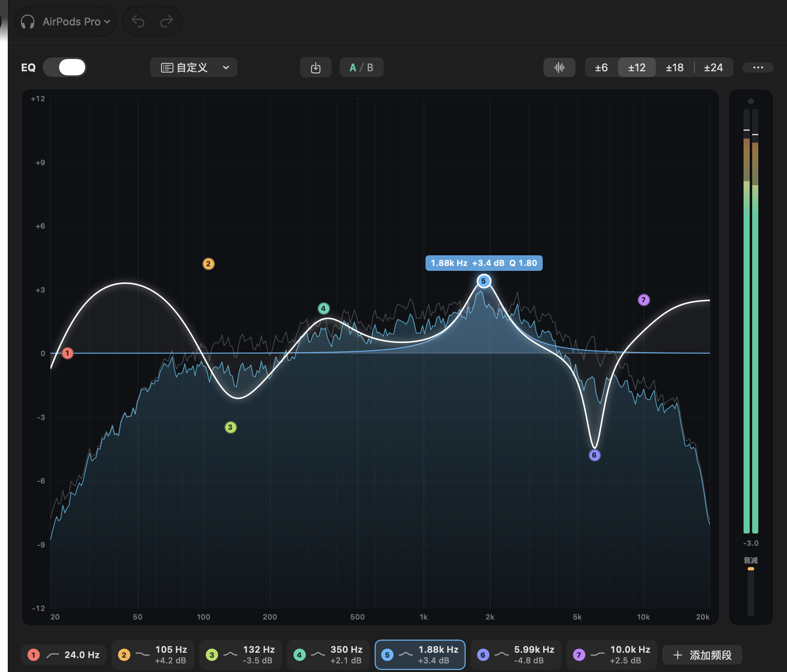
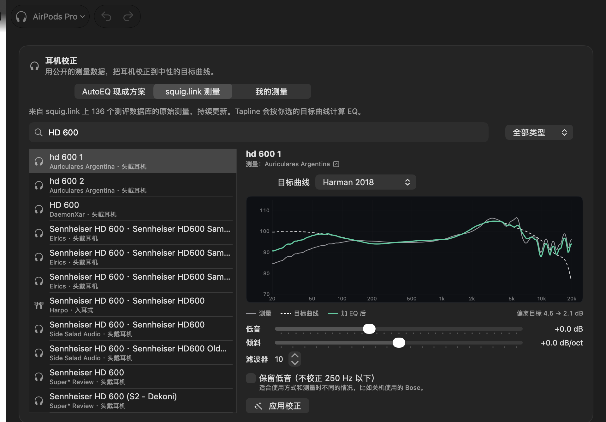
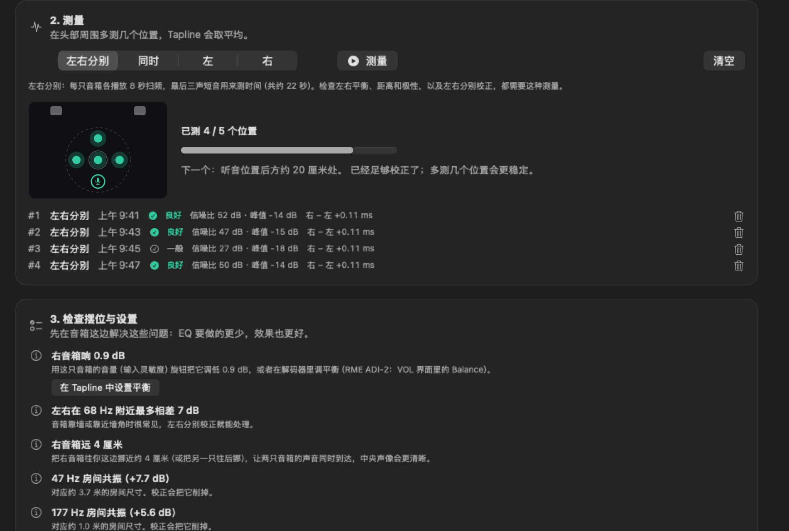
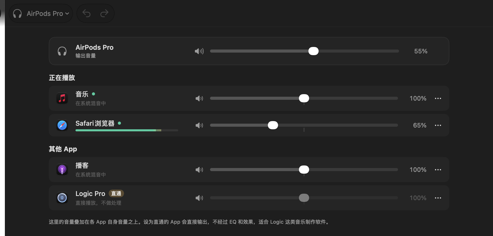
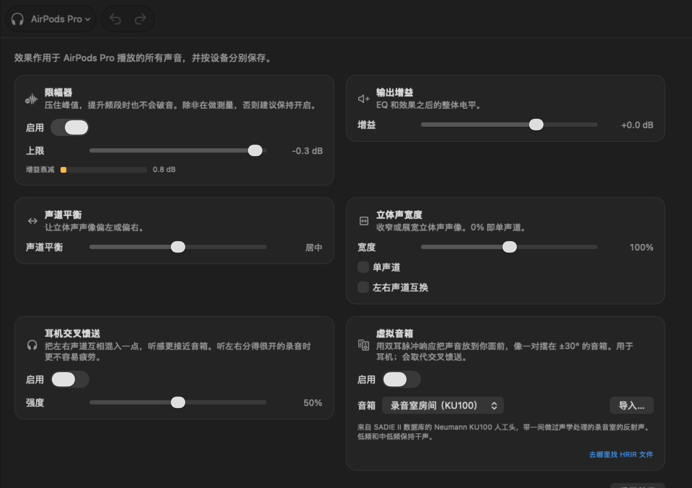
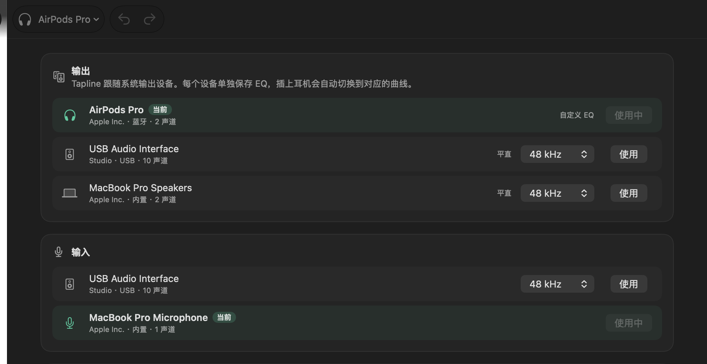
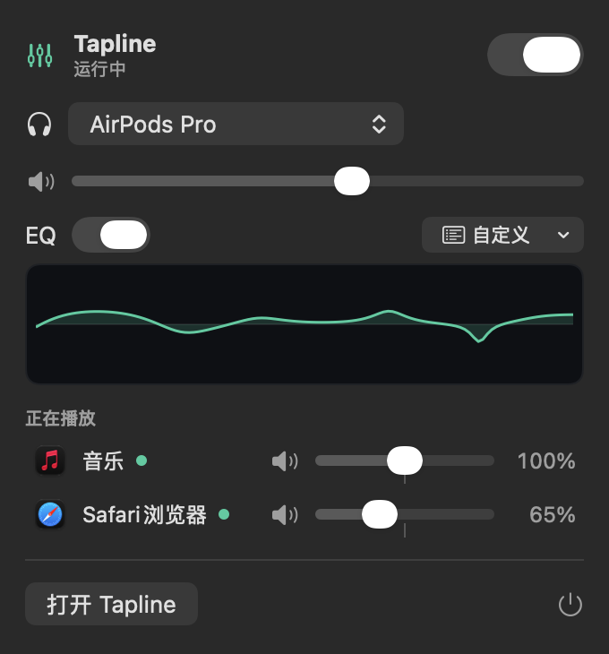

<p align="center">
  
</p>

<h1 align="center">Tapline</h1>

<p align="center">
  <a href="https://github.com/belugaming/tapline/actions/workflows/ci.yml"></a>
  <a href="https://github.com/belugaming/tapline/releases/latest"></a>
  
  
  <a href="#windows-版测试版"></a>
  <a href="LICENSE"></a>
</p>

<p align="center">
  <b>macOS 全局参数均衡器、分应用混音器和耳机校正工具，现在也有 Windows 测试版。</b><br>
  在 macOS 上不装驱动，不建虚拟声卡，基于 Core Audio 的进程截取接口实现。<br>
  <a href="#windows-版测试版">Windows 版</a>目前是测试版，基于 Equalizer APO。<br>
  <a href="README.md">English</a>
</p>

https://github.com/user-attachments/assets/022a002c-c52c-459e-8b60-b277e9fa475c



## Tapline 是什么？

Tapline 夹在各个 App 和你的音箱、耳机之间，让你调整听到的所有声音：带实时频谱的精确参数 EQ、每个 App 单独调音量、根据公开测量数据算出的耳机校正曲线，以及几种听音效果。它常驻在菜单栏，自动跟随 macOS 当前的输出设备，每个设备各自保存一套设置。

Tapline 也推出了 Windows 10 和 11 的**测试版**，页面和 macOS 版一样，基于 Equalizer APO。详见 [Windows 版（测试版）](#windows-版测试版)。

和同类软件相比：

- **不用装驱动。** 在 macOS 上，Tapline 用的是 macOS 14.2 起提供的进程截取接口，不往系统里加任何组件。Tapline 一退出，声音马上恢复原样。
- **看得见的 EQ。** 直接在频响曲线上拖动频点，同时看到 EQ 前后的频谱，可以 A/B 对比，所有操作都能撤销。
- **耳机校正跟得上新品。** 可以直接套用 AutoEQ 的 5000 多款现成方案，也可以让 Tapline 根据 squig.link 上 4 万多条原始测量自己算 EQ，上周刚出的耳机也能用。
- **音箱房间校正。** 用麦克风在你坐的位置测量音箱：Tapline 会检查左右平衡、距离、极性和摆位，压住房间造成的低频驻波，还能把校正写进 RME ADI-2 DAC。
- **听歌好用，做音乐也不碍事。** 在混音器里把 DAW 设成直通，它的声音就完全不受影响。
- **免费开源**（GPL-3.0），用 Swift 编写，实时音频核心用 C 编写；Windows 版用 C# 编写。

## 目录

- [系统要求](#系统要求)
- [安装](#安装)
- [Windows 版（测试版）](#windows-版测试版)
  - [Windows 版功能一览](#windows-版功能一览)
  - [在 Windows 上安装](#在-windows-上安装)
  - [在 Windows 上使用](#在-windows-上使用)
  - [更新和卸载](#更新和卸载)
- [快速上手](#快速上手)
- 教程
  - [1. 用均衡器调声音](#1-用均衡器调声音)
  - [2. 校正你的耳机](#2-校正你的耳机)
  - [3. 校正音箱和房间](#3-校正音箱和房间)
  - [4. 不懂 EQ 也能调](#4-不懂-eq-也能调)
  - [5. 每个 App 单独调音量](#5-每个-app-单独调音量)
  - [6. 效果器](#6-效果器)
  - [7. 多个设备、多套配置](#7-多个设备多套配置)
  - [8. 菜单栏和快捷键](#8-菜单栏和快捷键)
  - [9. 怎么看电平表](#9-怎么看电平表)
  - [10. 模拟其他设备试听](#10-模拟其他设备试听)
- [常见问题](#常见问题)
- [工作原理](#工作原理)
- [隐私与联网](#隐私与联网)
- [从源码编译](#从源码编译)
- [版本号与发布](#版本号与发布)
- [致谢](#致谢) · [许可证](#许可证)

## 系统要求

**macOS**

- macOS 26 Tahoe 或更高版本
- Apple Silicon 芯片的 Mac

**Windows（测试版）**

- 64 位 Windows 10 或 11，x64 电脑（不支持 ARM 版 Windows，因为 Equalizer APO 只有 x64 版本）
- 免费的 [Equalizer APO](https://sourceforge.net/projects/equalizerapo/)，并在要用的输出设备上启用

## 安装

以下是 macOS 的安装步骤。Windows 请看[在 Windows 上安装](#在-windows-上安装)。

1. 从[最新版本](https://github.com/belugaming/tapline/releases/latest)下载 `Tapline-x.y.z-arm64.dmg`。
2. 打开它，把 **Tapline.app** 拖到旁边的 **应用程序** 图标上。
3. 打开 Tapline。发布版还没有经过 Apple 公证，所以第一次打开会被系统拦下。到 **系统设置 → 隐私与安全性**，拉到最下面，在 Tapline 的提示旁边点 **仍要打开**。（从 macOS 15 开始，右键选"打开"已经不能绕过这个检查。）

更新时，退出 Tapline，用新版本替换掉旧的 App 就行。发布版用 Tapline 自己的证书签名，所以更新后系统会保留音频权限。从更早的临时签名版本更新过来时，还会再要一次。

## Windows 版（测试版）

Tapline 也能在 64 位 Windows 10 和 11 上运行。Windows 版的页面和 Mac 版一样（均衡器、助手和耳机校正、房间校正、混音器、效果器、设备），每个输出设备也各自保存一套 EQ。

> [!NOTE]
> Windows 版目前是**测试版**。它刚推出，还没有在很多电脑上测试过，难免有不完善的地方。欢迎到 [Issues](https://github.com/belugaming/tapline/issues) 反馈哪些能用、哪些不行。

Windows 没有 macOS 进程截取（process tap）那样的接口，所以 Tapline 在 Windows 上用免费开源的 [Equalizer APO](https://sourceforge.net/projects/equalizerapo/) 作为音频引擎：Tapline 负责编辑，Equalizer APO 在 Windows 的音频引擎里实际处理声音。Windows 版有自己的版本号（0.1.0-beta.x），以预发布版的形式发布，标题以 “Tapline for Windows” 开头；每个版本的改动见 [windows/CHANGELOG.md](windows/CHANGELOG.md)。

### Windows 版功能一览

| 功能 | macOS | Windows（测试版） |
|---|---|---|
| 参数 EQ，最多 24 个频段：在曲线上拖动、预设、A/B 对比、撤销、自动预增益 | ✓ | ✓ |
| 只作用于左声道或右声道的频段 | ✓ | ✓ |
| 旁通 EQ 时匹配响度 | ✓，交叉淡化 | ✓ |
| 每个输出设备各自一套 EQ | ✓ | ✓，关闭 Tapline 后依然有效 |
| 频谱分析 | EQ 前和 EQ 后 | 只有 EQ 后 |
| 耳机校正：AutoEQ、squig.link、自己的测量文件 | ✓ | ✓ |
| 房间校正：引导测量、摆位检查、左右分别校正、导出到 RME ADI-2 | ✓ | ✓ |
| 快速音色、声音助手、导入导出（Equalizer APO、AutoEQ、RME ADI-2） | ✓ | ✓ |
| 每个 App 单独调音量、静音 | 0–200% | 0–100%（Windows 自带的各应用音量） |
| 让某个 App 直通、不经过 Tapline | ✓ | ✗（使用独占模式或 ASIO 的软件本来就不会被处理） |
| 限幅器 | ✓ | ✗（请把预增益保持在**自动**） |
| 输出增益、声道平衡、立体声宽度、单声道、左右互换、交叉馈送 | ✓ | ✓（单声道输出设备上只有输出增益） |
| 虚拟音箱（HRIR/BRIR 卷积，导入 HeSuVi） | ✓ | ✓（用 Equalizer APO 的卷积器） |
| 模拟试听：用自己的耳机听其他耳机（squig.link）和日常设备扬声器的声音 | ✓，响度匹配 | ✓，提升可能削波时会比响度匹配更小声（没有限幅器） |
| 切换输出、输入设备 | ✓ | ✓ |
| 修改设备采样率 | ✓ | ✗（只显示） |
| 快捷面板 | 菜单栏 | 通知区域（托盘） |
| 全局快捷键 | ⌃⌥⌘P / B / K / L | Ctrl+Alt+Shift+P / B / K / L |
| 登录时打开 | ✓ | ✓ |

### 在 Windows 上安装

1. 安装 [Equalizer APO](https://sourceforge.net/projects/equalizerapo/)。安装结束时会弹出 Configurator：勾选你要用的输出设备（音箱、耳机……），然后重启 Windows。
2. 在[发布页](https://github.com/belugaming/tapline/releases?q=windows)中找到标题以 “Tapline for Windows” 开头的最新版本，下载 `Tapline-x.y.z-win-x64-setup.exe` 并运行。程序还没有代码签名，SmartScreen 可能会拦截：点 **更多信息 → 仍要运行**。
3. 打开 Tapline。如果 Equalizer APO 里已经有配置，Tapline 会先征求你的同意再替换：点**使用 Tapline**，或者点**把原 EQ 导入为预设，然后使用 Tapline**，把原来的 EQ 留成一个预设。原配置还会备份为 `config-before-tapline.txt`，可以在 **设备 → 音频引擎** 中恢复。
4. 放点音乐，选一个预设，或者接着看下面的[教程](#教程)。

### 在 Windows 上使用

教程以 Mac 版为例。Windows 版的页面用法相同，每节教程下面都注明了 Windows 上的不同之处。简单来说：

- **按键**：把 ⌘ 换成 Ctrl，⌥ 换成 Alt。窗口里：Ctrl+Z 撤销，Ctrl+Y 重做，Ctrl+B 旁通 EQ，Ctrl+K A/B 对比。全局快捷键（可以在**设置**里关掉）：Ctrl+Alt+Shift+P 开关处理，Ctrl+Alt+Shift+B 旁通 EQ，Ctrl+Alt+Shift+K 切换 A/B，Ctrl+Alt+Shift+L 开关模拟试听。
- **关闭 Tapline 后 EQ 依然有效**，因为是 Equalizer APO 在处理声音，重启电脑后也一样。要听原声，请关闭处理：电源按钮、托盘面板、Ctrl+Alt+Shift+P，或者 **设置 → 处理音频**。
- **通知区域（托盘）**：点 Tapline 的图标打开快捷面板（处理开关、输出设备、音量、EQ 和预设、模拟试听、正在播放的 App）；右键点图标可以退出。关闭窗口后 Tapline 会留在托盘里继续运行；在**设置**里关掉这一项，关闭窗口就会退出。
- **只有装了 Equalizer APO 的设备才会被处理。** 设备页会给其他设备标上**未装 Equalizer APO**：在 Equalizer APO 的 Configurator 里勾选它们（横幅上的**打开 Configurator**），然后重启。如果某个设备关闭了 Windows 的**音频增强**，Equalizer APO 也会被跳过，Tapline 会显示横幅，可以直接打开声音设置。从没调过 EQ 的输出设备不做任何处理。
- **房间测量**期间，Tapline 会把被测的输出设备暂时从 Equalizer APO 的配置里拿掉，所以这几十秒里这个设备上的所有声音都不经过处理。如果麦克风只录到静音，请在 Windows 的隐私设置里允许访问麦克风（**打开麦克风设置**）。
- 界面语言跟随 Windows 的显示语言（英文或简体中文）。

### 更新和卸载

更新时，直接运行新版本的安装程序，EQ 和预设都会保留。卸载时，在 **设置 → 应用** 中移除 Tapline，卸载程序会把 Equalizer APO 原来的配置还回去。Tapline 的设置保存在 `%APPDATA%\Tapline`，想一并清除就删掉这个文件夹。

## 快速上手

快速上手和教程以 macOS 版为例。Windows 请按[在 Windows 上安装](#在-windows-上安装)操作，不用看这里的快速上手；教程同样适用，Windows 上不同的地方都有注明。

1. **退出其他音频工具**，比如 SoundSource、eqMac。两个工具同时处理同一路声音会互相干扰，Tapline 检测到时会显示警告。
2. 点窗口左下角的**电源按钮**开启 Tapline，或者按 ⌃⌥⌘P。
3. 系统弹出**录制系统音频**权限时点**允许**。有了这个权限，Tapline 才能处理其他 App 的声音。声音不会离开你的 Mac。
4. **放点音乐。** 频谱会动起来，右边的电平表会显示输出音量。
5. 在均衡器页顶部的菜单里**选一个预设**，或者接着看下面的教程。

关掉窗口或按 ⌘Q 后，Tapline 会继续在菜单栏运行，Dock 图标会消失，等你再打开窗口时才出现。要彻底退出，点菜单栏面板里的电源按钮，或按 ⌥⌘Q。在 **设置 → 登录时打开 Tapline** 打勾，开机就会自动启动。

## 教程

### 1. 用均衡器调声音

**均衡器**页是 Tapline 的核心。大图里白色的是 EQ 曲线，后面蓝色的是正在播放的声音的实时频谱，淡灰色的线是 EQ 之前的频谱。

| 想要 | 这样操作 |
|---|---|
| 移动频段 | 拖动带编号的点：左右改频率，上下改增益 |
| 改宽窄（Q 值） | 鼠标放在点上滚动滚轮，或用触控板双指缩放 |
| 添加频段 | 双击图上空白的地方，或点 **添加频段** |
| 删除频段 | 按住 ⌥ 点它、按删除键，或点垃圾桶按钮 |
| 精细调节 | 拖动时按住 ⌥，或者选中后用方向键 |
| 换滤波器类型 | 右键点频点，或用图下方的形状按钮 |

图的下方：

- **频段标签**：列出所有频段，点一下就选中。
- **编辑区**：滤波器类型（峰值、低频搁架、高频搁架、低通、高通、陷波、带通）、开关，以及**频率**、**增益**、**Q** 三个旋钮。旋钮可以上下拖，双击恢复默认，点数值可以直接输入（比如输入 `1.2k`）。
- **预增益**和**自动**：自动把整体音量降低"曲线的最大提升量"，保证 EQ 不会破音。所以提升低音以后整体会变小声一点，把音量调大补回来就行。

页面顶部：

- **EQ** 开关：关掉当前设备的 EQ。在任何 App 里按 **⌃⌥⌘B** 都能和原声对比。这个对比是公平的：校正曲线的预增益会让声音比原声小几 dB，而更响的声音几乎总是听起来更好，所以 EQ 关掉时，Tapline 会让原声以 EQ 的响度播放。补偿量显示在开关旁边（例如 *已匹配响度 −4.6 dB*），它是整个 EQ 对粉红噪声造成的响度变化，按 LUFS 响度表的方式加权（ITU-R BS.1770），并且永远不会提高音量。想听原声本来的音量，就在 **设置 → EQ 旁通** 里关掉 **旁通时匹配响度**。切换时会在几毫秒内交叉淡入淡出，不会有爆音。
- **预设菜单**：内置预设（低音增强、人声清晰、响度补偿等）和你自己的预设，菜单最下面是 **删除预设**。
- **保存**（下载图标）：把当前曲线存成预设。勾上**包含效果设置**，会把交叉馈送、限幅器等效果一起存进去。
- **A / B**：两套互相独立的设置。在 B 上改，然后来回切换听差别。
- **范围**（±6 到 ±24 dB）和**输入频谱**开关。
- **⋯**：恢复平直、把 A 复制到 B、把曲线复制为 Equalizer APO 格式。

所有改动都可以撤销和重做（⌘Z / ⇧⌘Z）。

> **Windows 上：** 用 Ctrl 代替 ⌘，Alt 代替 ⌥（Alt 点按删除频段；按住 Alt 或 Shift 微调）。滚轮调 Q 值，不支持双指捏合。曲线图只显示 EQ 之后的频谱，所以没有“输入频谱”开关。撤销和重做是 Ctrl+Z 和 Ctrl+Y。旁通时的响度匹配是 Equalizer APO 配置里的一行 `Preamp`，切换时没有交叉淡化。

### 2. 校正你的耳机

每副耳机都会给声音染色，校正曲线能把它拉回到中性的目标。打开 **辅助调音 → 耳机校正**，选一个来源：



**AutoEQ 现成方案**：5000 多款耳机算好的校正曲线。搜索型号，选一个结果，点 **应用校正**。有 oratory1990 和 crinacle 的结果时会排在前面。AutoEQ 数据库最后更新于 2025 年 7 月，较新的耳机可能搜不到。**强度**可以只应用一部分曲线：50 % 时每个频段的增益减半。

**squig.link 测量**：来自 130 多个测评者数据库的原始测量，持续更新，由 Tapline 自己计算 EQ：

1. 搜索型号。每条结果会写着谁测的、用什么设备测的。名称里通常会注明测量时的模式（降噪开或关、有线、无源 passive、音量档位等），**选和你实际使用一致的那个**。
2. 选一条**目标曲线**。每个数据库都有和自己测量设备匹配的目标曲线，先从 Harman 开始试比较好。
3. 看图：**灰线**是耳机实测的声音，**虚线**是目标，**绿线**是加上 Tapline 的 EQ 之后的效果。绿线越贴近虚线越好。右下角的*偏离目标*是校正前后和目标的平均差距。
4. 按喜好微调：**强度**决定应用多少校正，类似干/湿比控制：50 % 时，EQ 拟合的是耳机原声和目标之间正中间的那条曲线，所以绿线落在中间，*偏离目标*显示还剩多少差距。**低音**在目标基础上再加低频，**倾斜**往右更亮、往左更暖，**滤波器**是用几个频段来拟合（10 个就够了）。
5. 点 **应用校正**。曲线会应用到当前的输出设备，同时存成预设，之后还可以继续改。

**我的测量**：导入你自己测的频响数据（REW、miniDSP EARS、CSV），从任意数据库里选目标曲线来拟合。**强度**、**低音**、**倾斜**和**滤波器**的用法和 squig.link 一样。

几点建议：

- **保留低音（不校正 250 Hz 以下）**：适合使用方式和测量时不一样的情况。比如降噪耳机关机插线（无源）使用时，电路不工作，低音和开机时差别很大，按测量数据去校正低音反而会出错。
- 8 kHz 以上的高音只做大致校正，因为不同测量设备在这一段的结果差别很大。
- AirPods 这类自适应耳机会根据音量和佩戴情况自己改 EQ，校正只能做到大致准确。按 ⌃⌥⌘B 对比一下，哪个好听用哪个。
- 完整校正刚开始可能听着别扭，因为耳朵已经习惯了你的耳机。可以先把**强度**调低一些，比如 70 %，以后想要再调高。用 ⌃⌥⌘B 对比时旁通是匹配响度的，听到的是音色差别，而不是音量差别。

### 3. 校正音箱和房间

音箱放进房间以后，低音会被墙壁反射改变：有的音特别轰，有的音几乎听不见。**房间校正**页会用麦克风在你坐的位置测量音箱，先告诉你哪些问题应该在音箱上解决，再算出 EQ：可以由 Tapline 运行，也可以写进 RME ADI-2 DAC 自带的 EQ。



**需要准备**：一支能被 Mac 识别的麦克风。最好是测量麦克风（miniDSP UMIK-1/UMIK-2，或者接在声卡上的 XLR 测量话筒）；好的录音棚电容麦测低频也完全够用。电容麦需要在声卡上打开 48V 幻象电源。Mac 自带的麦克风只能作为大致参考。麦克风和音箱可以接在不同的声卡上。

1. **准备**：暂停所有音乐，保持房间安静，把音量调到舒适的大小。测量会按当前输出音量播放。关掉解码器（包括 RME ADI-2）里的 EQ、低音/高音和响度补偿，让 Tapline 测到音箱本来的样子。虚拟输出设备背后的软件（比如 SoundID Reference）也一样要关掉：输出或输入是虚拟设备时，Tapline 会给出提醒。
2. **麦克风**：选择麦克风所在的**输入**设备和**声道**。如果麦克风附带了**校准文件**，载入它。把麦克风放在你平时坐的位置、耳朵的高度，指向两只音箱中间。
3. **检查电平**：Tapline 会播放三秒粉红噪声。调整音量或话放增益，让麦克风的峰值落在 −30 到 −10 dB 之间。
4. **测量**：选**左右分别**。一次测量会在每只音箱上各播放 8 秒扫频，最后是三声用来测时间的短音（共约 22 秒）。在头部周围测 3 到 5 个位置，Tapline 会取平均。按钮下方的示意图会标出下一个该放麦克风的位置（先是听音位置，然后是左、右、前、后各约 20 厘米），以及已经测了几个。测量过程中会显示正在播放的音箱、剩余秒数和麦克风电平。每条测量记录会标为**良好**、**一般**或**建议重测**（削波、噪声大，或和其他位置明显不同）；用垃圾桶按钮删掉，在那个位置重测即可。**同时**是两只音箱一起测，**左**、**右**只测一边。
5. **检查摆位与设置**：Tapline 会列出更适合在音箱上解决、而不是靠 EQ 的问题：
   - **极性**：有一只音箱接反了。
   - **左右平衡**：一边比另一边响。可以在音箱或解码器上调，也可以让 Tapline 设置平衡。
   - **距离**：一只音箱比另一只远，精确到厘米。测时间的短音会抵消两台声卡之间的时钟漂移，所以麦克风接一台声卡、音箱接另一台也能测准。
   - **超低音音量**、**中低频发轰**和**桌面反射**，并告诉你拨哪个开关（真力音箱：Bass Tilt、Desktop Control、Treble Tilt）。
   - **房间共振**（附上对应的房间尺寸），以及 EQ 补不平的**深凹陷**，并建议怎么处理（超低音的相位开关、挪动座位或音箱）。
6. **校正**：选择校正在哪里运行。
   - **Tapline**：校正这台 Mac 播放的声音。点 **应用到 …**，同时存成预设。
   - **RME ADI-2 DAC**：按解码器自带的参数 EQ 来拟合：每声道 5 段，第 4、5 段从 200 Hz 起，步进 0.5 dB。点**导出到 ADI-2 Remote…**，然后在 RME 的 ADI-2 Remote 里打开 **EQ Presets**，点 **File – Load** 选中文件，再 **Store** 存进设备。之后接在这台解码器上的所有音源都会被校正。可以先点**在 Tapline 中试听**。两处只选一处，不要同时开，否则会校正两次。
   - **左右分别校正**（用“左右分别”测量后默认打开）：每只音箱单独拟合；在 ADI-2 上会使用 Dual EQ。
   - 图上显示实测频响（灰线）、目标（虚线）和校正后的效果（绿线），下面列出各个滤波器。测了多个位置时，灰色带表示各位置之间的离散度（一个标准差）：越宽，平均值越不可靠。勾选**各位置**可以画出每个位置的曲线。**校正上限**（默认 500 Hz）以上保留音箱自己的调音。上限最高可设到 20 kHz：超过约 2 kHz 时，EQ 也会修正音箱本身（比如分频点附近的凹陷、偏亮的高音单元），这时需要多测几个位置，最好使用带校准文件的麦克风。**最大提升**（默认 3 dB）让凹陷只补一点：凹陷是声波在你座位处互相抵消造成的，硬提升主要是在消耗功放余量。Tapline 也不会在音箱的低频下潜极限以下做提升。目标可以选**平直**或**房间曲线**（低频稍微抬升、高频轻微下倾），再用**低音**和**倾斜**微调。

**复制滤波器参数**会给出 Equalizer APO 格式的滤波器（左右分别校正时带 `Channel: L` / `Channel: R` 段落），可以输入到其他硬件 EQ。

建议：测量信号不经过 Tapline 自己的 EQ 和平衡，所以再测一次看到的总是房间本来的样子。想检查已经载入 ADI-2 的校正，打开它的 EQ 再测一次。超低音的分频和延时请用超低音自己的旋钮设置；如果你的音箱自带校准系统（比如真力 SAM 系列的 GLM），优先用它。

> **Windows 上：** 房间校正的用法完全相同。检查电平或测量期间，被测输出设备上的所有声音都不经过 Tapline 的 EQ 和效果，而不只是测试信号。

### 4. 不懂 EQ 也能调

**辅助调音**页往下拉：

- **快速音色**：四个旋钮，**低音**（105 Hz 低频搁架）、**温暖度**（250 Hz）、**清晰度**（3 kHz）、**空气感**（10 kHz 高频搁架），叠加在 EQ 之上。
- **声音助手**：说说你听到的问题，比如"更多低音""低音不轰""不那么浑浊""人声更清晰""不那么刺耳""减轻齿音""更多空气感"。每点一次做一点小调整，可以撤销。
- **预设**：所有预设和它们的曲线预览，你自己的预设卡片上有重命名和删除按钮。
- **导入与导出**：粘贴或导入 Equalizer APO / AutoEQ 的 `ParametricEQ.txt` 文件或 RME ADI-2 的预设（`.adieqpr`），也可以导出你自己的。**导出给 RME ADI-2…** 会把当前 EQ 转成 ADI-2 预设：钟形滤波器放进它的 5 个频段，一个低搁架变成 Bass，一个高搁架变成 Treble。

### 5. 每个 App 单独调音量



**混音器**页列出所有在用音频的 App，正在播放的排在最上面。

- 拖动滑块调整某个 App 的音量（0–200%），叠加在 App 自己的音量之上，拖到 100% 附近会自动吸附。
- 点喇叭图标静音这个 App。
- **⋯ → 不经过 Tapline（直通）**：让这个 App 直接输出，不经过 EQ 和效果。适合 Logic Pro 这类音乐制作软件、语音通话，或者任何你想听原声的场合。
- **⋯ → 重置**：让这个 App 回到系统混音里。

第一次调某个 App 的音量时，Tapline 要为它重建音频通路，会短暂停一下。浏览器标签页、Electron 应用这类辅助进程会自动归到对应的 App 名下。

> **Windows 上：** 滑块调的是 Windows 自带的各应用音量，和音量合成器里的一样：范围 0–100%，关闭 Tapline 后依然保留。没有**直通**和**重置**。使用独占模式或 ASIO 的软件（大多数音乐制作软件）本来就不经过 EQ。

### 6. 效果器



**效果**页作用于当前设备播放的所有声音：

- **限幅器**：压住峰值，提升频段也不会破音。建议保持开启，**衰减（GR）**表会显示它什么时候在工作。
- **输出增益**：EQ 之后的整体电平。
- **声道平衡**、**立体声宽度**（0% 就是单声道）、**单声道**、**左右声道互换**。
- **耳机交叉馈送**：把左右声道互相混入一点，听感更接近音箱。听左右分得很开的录音时，用耳机不容易疲劳。
- **虚拟音箱**：把音乐放到你面前，像是从一对音箱里放出来，而不是在脑袋里。详见下文。它和交叉馈送二选一：打开一个，另一个会自动关掉。

> **Windows 上：** 没有限幅器，因为 Equalizer APO 没有这个功能。请把预增益保持在**自动**，避免提升频段时破音；电平表顶满时调低**输出增益**。**虚拟音箱**用 Equalizer APO 自带的卷积器，和 HeSuVi 一样：Tapline 按设备的采样率把脉冲响应写进 Equalizer APO 的 `config\Tapline\VirtualSpeakers` 文件夹。

#### 虚拟音箱

用耳机听，左声道只进左耳。用音箱听，两只耳朵都能听到两只音箱：远的那只稍晚一点、也更闷一点，并且经过头部、耳廓和房间的塑形。虚拟音箱用双耳脉冲响应（HRIR；带房间的叫 BRIR）重现这一点：在人工头（或你自己）的耳道里放麦克风，测出摆在 ±30° 的一对音箱。思路和 Sonarworks SoundID Virtual Monitoring 一样，但免费。

- **录音室房间（KU100）**（默认）：来自 [SADIE II](https://www.york.ac.uk/sadie-project/database.html) 数据库的 Neumann KU100 人工头，带一间做过声学处理的录音室的早期反射声。反射声能让声音离开脑袋；低频和中低频里不加反射，保持干净。
- **消声室（KU100）**：同一个人工头，没有房间。声音最干净，但往往离头更近。
- **导入…** 你自己的：HeSuVi 文件（7 或 14 声道）、Impulcifer 的 `hesuvi.wav` 或 `hrir.wav`、4 声道文件（左前→左耳、左前→右耳、右前→左耳、右前→右耳），或两个立体声文件、每只音箱一个（Tapline 会自己判断哪个是左）。Tapline 只用左前和右前两只音箱，并重采样到设备的采样率。导入的组合列在**已导入**下面，点**移除**可以删掉。

使用建议：

- 配合耳机校正一起用（见[2. 校正你的耳机](#2-校正你的耳机)）。内置的组合做过扩散场均衡，适合校正到中性（Harman 或扩散场）目标的耳机。
- 打开时会自动匹配响度，可以直接开关对比。限幅器照样保护输出。
- 打开时会增加 256 个采样的延迟（48 kHz 下 5.3 毫秒）。用音箱听时请关掉。
- 通用人工头对不同的人效果不一样：如果人声像是从后面或上面来的，换一组试试。

去哪里找更多组合：

- [HeSuVi](https://sourceforge.net/projects/hesuvi/)：下载包里的 `hrir` 文件夹有很多组人工头和房间，都是它的 14 声道格式。同一组有几种采样率时，选和设备一致的，免得重采样。
- [ASH Listening Set](https://github.com/ShanonPearce/ASH-Listening-Set)：很多房间的 BRIR，有 HeSuVi 格式，也有每个方向一个的立体声文件（把 30° 和 330° 两个文件一起导入）。只允许非商业使用。
- **你自己的头**：[Impulcifer](https://github.com/jaakkopasanen/Impulcifer) 用一副入耳式双耳麦克风、你的音箱和耳机，在你的房间里测量你的耳朵，生成 `hesuvi.wav`。导入它就是最接近个人校准的方式，类似 SoundID Virtual Monitoring PRO 用它的麦克风做的事。

### 7. 多个设备、多套配置



Tapline 跟随 macOS 当前选中的输出设备，**每个设备各自保存一套 EQ 和效果**。插上耳机就自动用耳机那套，切回音箱就恢复音箱那套。

- **设备**页列出所有输出和输入设备，点**使用**切换，也可以改采样率。
- 工具栏里的输出设备菜单在任何页面都能切换设备。

> **Windows 上：** 点**使用**会把它设成 Windows 的默认设备。采样率只显示，不能在 Tapline 里修改。**音频引擎**卡片显示 Equalizer APO 的状态，可以打开它的 Configurator 和配置文件。
- 如果一台设备同时接了耳机和音箱（比如声卡），可以存两个勾选了**包含效果设置**的预设，比如"耳机"开交叉馈送、"音箱"不开，在预设菜单或菜单栏里一键切换。

### 8. 菜单栏和快捷键



点菜单栏里的 Tapline 图标会弹出一个小面板：总开关、输出设备、系统音量、EQ 开关和当前曲线、预设菜单、**模拟试听**开关，以及正在播放的 App。点曲线图可以打开主窗口。

全局快捷键在任何 App 里都能用，可以在**设置**里关掉：

| 快捷键 | 作用 |
|---|---|
| ⌃⌥⌘P | 开启或关闭处理 |
| ⌃⌥⌘B | 旁通 EQ（以相同响度和原声对比） |
| ⌃⌥⌘K | A/B 对比 |
| ⌃⌥⌘L | 开关模拟试听（见 [10. 模拟其他设备试听](#10-模拟其他设备试听)） |

在 Tapline 里：⌘Z / ⇧⌘Z 撤销和重做，⌘B 旁通 EQ，⌘K A/B 对比，⌘Q 隐藏到菜单栏，⌥⌘Q 彻底退出。

> **Windows 上：** 面板从通知区域（托盘）里的 Tapline 图标打开，右键点图标可以退出。全局快捷键是 Ctrl+Alt+Shift+P / B / K / L；在 Tapline 里 Ctrl+Z / Ctrl+Y 撤销和重做，Ctrl+B 旁通 EQ，Ctrl+K A/B 对比。关闭窗口后 Tapline 会留在托盘里。

<br clear="right">

### 9. 怎么看电平表

曲线图右边那一栏是左右声道的输出电平：

- **绿色实心**是平均音量，**上面颜色淡一点的那截**是瞬间峰值，**白色短横线**是最近的最高峰值，下面的数字就是它的 dB 值。0 dB 是数字信号的上限。
- **最上面的小圆点**变红表示削波（破音）了。
- **衰减（GR）**表示限幅器正在把峰值压低多少。空着最好；如果经常在动，就把预增益调低一点，或者打开**自动**。

> **Windows 上：** 没有限幅器，所以也没有 GR 表。削波指示灯变红时，调低预增益或打开**自动**。

### 10. 模拟其他设备试听

在好耳机上练琴、混音时，你可能想知道大多数人听到的是什么样：耳塞、手机、笔记本电脑、汽车。**辅助调音 → 模拟试听**让你用自己的耳机听到音乐在这些设备上的样子，类似 Sonarworks SoundID 的 Translation Check。它叠加在你的 EQ 和耳机校正之上，不会改动它们，也永远不会存进预设。

**耳机与耳塞**（精确）：在 squig.link 的测量数据里搜索一个设备，比如 *AirPods Pro 2*、*Apple EarPods* 或 *Galaxy Buds*，然后选中它。Tapline 会拟合一条 EQ，把你的耳机校正所追求的声音变成这个设备的声音：图上灰线是你的声音，虚线是设备，绿线是模拟结果。点**模拟这个设备**。

- 如果这个设备和你的耳机来自同一个数据库（你在 **squig.link 测量** 里选的那个），Tapline 直接使用设备和你的目标曲线之间的差异。
- 否则它会把设备和它自己数据库里的目标曲线对比（与你的目标同名的那条，或者 Harman 目标；可以在**对比目标**里换），两套测量设备的差异因此相互抵消。卡片上会注明是哪种情况。
- 10 kHz 以上只模拟大致趋势，和耳机校正一样。
- 先校正你自己的耳机（见 [2. 校正你的耳机](#2-校正你的耳机)）：模拟以你的校正所追求的目标曲线为起点。

**设备扬声器**（近似）：点**手机扬声器**、**笔记本电脑扬声器**、**电视扬声器**、**小型蓝牙音箱**或**汽车**。每一项都是一条频响曲线（低频在哪里截止、典型的共振、高频）加上声道处理：手机和蓝牙音箱是单声道，笔记本电脑是窄立体声。它们是依据这类扬声器的一般特性编写的近似模拟，不是任何产品的实测数据。再点一次同一项即可停止。

切换时**响度一致**：一个补偿增益抵消设备曲线对粉红噪声的响度变化（按 LUFS 响度表的方式加权），让你比较的是音色而不是音量。限幅器关闭时，Tapline 会改为保留余量，卡片上会注明模拟小声了多少。

在卡片上、菜单栏面板里或按 ⌃⌥⌘L 开关它。Tapline 会记住上次选的设备；模拟本身每次启动 Tapline 时都是关闭的。

> **Windows 上：** 托盘面板里也有这个开关，快捷键是 Ctrl+Alt+Shift+L。模拟用的滤波器写在 Equalizer APO 配置里你的 EQ 之后，只作用于当前输出设备。Equalizer APO 没有限幅器，所以设备会把某个频率提升到超过你的 EQ 本身的最高电平时，模拟会相应地比响度匹配更小声；卡片上会注明小声了多少。

## 常见问题

**开了 Tapline 以后没声音。**
看一下 **设置 → 权限**。如果"录制系统音频"被拒绝了，点**打开隐私设置**，允许 Tapline，再重新开启。没有权限时，系统会把 App 静音，但交给 Tapline 的却是一片空白。

**加了 EQ 以后声音变小了。**
这是自动预增益在给你的提升留余量，防止破音。把音量调大就行。也可以在预增益旋钮下面关掉**自动**，改靠限幅器防破音。

**EQ 是平直的时候，Tapline 会影响音质吗？**
基本不会。声音全程用 32 位浮点处理，采样率和设备一致，不工作的滤波器会被直接跳过。只有三处可能有细微影响：峰值超过 −0.3 dB 时限幅器会介入（不想要可以在**效果**里关掉）；USB 和内置设备会开启系统的漂移补偿（高质量重采样，变速比极小）；以及大约 12 毫秒的额外延迟。

**杜比全景声和空间音频呢？**
这部分还没有充分测试。如果全景声歌曲或带头部追踪的空间音频在开启 Tapline 后听起来不一样，就在混音器里把对应的 App（比如"音乐"）设成**直通**。这样它会直接输出，空间音频效果完整保留，只是不经过 Tapline 的 EQ。

**蓝牙耳机有电流声或者声音发晃。**
更新到 0.1.1 或更高版本。新版本直接截取设备自己的输出流，能正确处理蓝牙时钟。

**房间校正能用录音棚麦克风吗？**
可以。好的电容麦在低频足够准确，而房间校正主要就是修低频。心形指向的麦克风放在耳朵高度、指向两只音箱中间，打开幻象电源，多测几个位置。Tapline 只在测量时使用麦克风，第一次使用时系统会询问麦克风权限。

**SoundSource 或其他工具还在运行。**
退出它。它的后台音频服务可能会一直留着，但只有在真正处理声音时 Tapline 才会提示。

**更新以后系统又要权限。**
改用 Tapline 自己的证书之前，发布版是临时签名的，每个版本在系统看来都是新 App，第一个用证书签名的版本也一样，再允许一次就行。旧的记录可以在 **系统设置 → 隐私与安全性 → 录屏与系统录音** 里删掉。

**Windows：开了 EQ 听不出区别。**
看窗口顶部的横幅。Equalizer APO 没装、没装在当前输出设备上，或者因为这个设备关闭了 Windows 的**音频增强**而被跳过时，Tapline 都会在那里提示。另外确认处理已经打开，以及播放的软件没有用独占模式或 ASIO：这两种都会绕过 Equalizer APO。

**怎么卸载？**
Windows 请看[更新和卸载](#更新和卸载)。在 macOS 上，从菜单栏面板退出 Tapline，删掉 Tapline.app。如果想清除设置和缓存，在终端运行：

```bash
defaults delete io.github.belugaming.Tapline
rm -rf ~/Library/Caches/io.github.belugaming.Tapline
```

## 工作原理

```
各个 App ──► 截取输出设备自己的输出流（Tapline 读取期间，原声在源头被静音）
        ──► 私有聚合设备 =［截取流 + 作为时钟源的输出设备］
        ──► C 语言音频回调：混合各 App → 预增益 → EQ → 音色 → 模拟试听 → 效果（含虚拟音箱） → 限幅器
        ──► 输出设备
```

- 一路截取流负责当前输出设备上的所有声音，Tapline 自己、设为直通的 App、单独调过音量的 App 除外；后两者各自有单独的截取流。截取设备自己的输出流，时钟就和设备一致。
- 有独立晶振的设备（USB、内置）开启漂移补偿；蓝牙和虚拟设备关闭，否则系统会插入或丢弃采样点。
- 实时音频部分用纯 C 编写（`Packages/TaplineCore/Sources/TaplineDSP`），音频线程上没有内存分配、锁或 Swift 运行时。参数通过无锁三缓冲传进去。滤波器是 RBJ 双二阶滤波器，用双精度计算。
- 虚拟音箱是均匀分段的 FFT 卷积（重叠保留法，每段 256 个采样，用 Accelerate 的实数 FFT），每条路径最长 65,536 个抽头。主线程把新的组合变换好，通过原子指针交给音频线程；音频线程交叉淡变过去，再把旧的交还给主线程释放。
- 模拟试听在 EQ 之后有一个独立的处理块：最多 16 个双二阶滤波器、一个补偿增益和一个中/侧宽度，开关时和 EQ 一样交叉淡化。耳机模拟用同一个 EQ 拟合算法，把参考目标曲线当作“测量”，把设备当作“目标”。
- EQ 旁通时，预增益、EQ 和音色由一个增益代替：整个 EQ 对粉红噪声的响度变化（按 ITU-R BS.1770 做 K 加权），最高 0 dB。开关 EQ 时，两条通路在一个音频缓冲内交叉淡化。
- EQ 拟合算法（`EQFitter.swift`）参照 AutoEQ 的做法：先对齐电平，平滑所需的校正量（8 kHz 以上用两个倍频程的平滑），在误差最大的地方逐个加搁架和峰值滤波器，再用模式搜索一起微调所有参数。强度低于 100 % 时，它拟合的是把测量曲线朝目标移动相应比例后的曲线，所以结果和完整校正一样准确。
- 同一时间只能运行一个 Tapline；设备停止回调时看门狗会自动重启引擎；检测到反馈回路时会自动关闭处理。Tapline 退出或崩溃时，它创建的截取流和聚合设备会一起消失。

在 Windows 上，Tapline 负责写 Equalizer APO 的 `config.txt`：每个输出设备一个 `Device:` 段，里面是它的预增益、滤波器（和 Mac 版一样的 RBJ 双二阶滤波器）、左右声道段落和效果。Equalizer APO 重新读取这个文件，在 Windows 的音频引擎里处理声音。频谱和电平表通过 WASAPI 环回捕获读取输出，房间测量用 WASAPI 共享模式播放和录音。

## 隐私与联网

所有声音都在你的电脑上处理，不会录音，也不会上传。只有使用耳机校正时才会联网：

- **AutoEQ**：从 GitHub 下载耳机列表和校正数据，缓存一周。
- **squig.link**：从各个测评者的 squig.link 站点下载站点目录、耳机列表、目标曲线和你打开的测量数据，下载后会缓存。在 squig.link 退出名单里的站点不会被访问。

## 从源码编译

需要 Xcode 27 或更高版本，以及 [XcodeGen](https://github.com/yonaskolb/XcodeGen)。

```bash
brew install xcodegen
git clone https://github.com/belugaming/tapline.git
cd tapline
xcodegen generate
xcodebuild -project Tapline.xcodeproj -scheme Tapline -configuration Release -derivedDataPath build build
open build/Build/Products/Release/Tapline.app
```

运行 DSP 核心的测试：

```bash
cd Packages/TaplineCore && swift test
```

本地编译出来的也是临时签名。在 Xcode 里设置你自己的开发团队，重新编译后就不用反复授权了。

### Windows

需要 [.NET 10 SDK](https://dotnet.microsoft.com/download)。Windows 版在 `windows/` 目录：`Tapline.Core`（从 Swift 移植的 EQ、拟合和房间校正代码）和 `Tapline`（WPF 应用）。

```bash
cd windows
dotnet test tests/Tapline.Core.Tests
dotnet publish src/Tapline/Tapline.csproj -c Release -r win-x64 --self-contained -p:PublishSingleFile=true -o artifacts/publish
```

核心代码的测试在 macOS 和 Linux 上也能跑，应用本身在这些系统上也能编译（`EnableWindowsTargeting`），但只能在 Windows 上运行。设置 `TAPLINE_SNAPSHOT_DIR=<文件夹>` 后，应用会把每个页面渲染成 PNG 然后退出，CI 用它在真正的 Windows 机器上检查界面。

## 版本号与发布

版本号遵循[语义化版本](https://semver.org/lang/zh-CN/)，只在 `project.yml` 的 `MARKETING_VERSION` 里定义一次；构建号是提交总数，由 CI 自动填入。改动记在 [CHANGELOG.md](CHANGELOG.md) 的 **Unreleased** 部分。

```bash
scripts/release.sh 0.2.0 --push
```

这个脚本会检查 `main` 分支有没有未提交的改动，然后更新版本号，把 Unreleased 整理成 `0.2.0`，提交、打 `v0.2.0` 标签并推送。接着[发布工作流](.github/workflows/release.yml)会在 GitHub 的 macOS 服务器上测试、编译，把 .dmg 磁盘映像连同这一段更新日志发布到 Releases。带后缀的版本（比如 `0.3.0-beta.1`）会标记为预发布版。每次推送到 `main`，[CI 工作流](.github/workflows/ci.yml)都会用 Xcode 27 编译一遍。

Windows 测试版单独定版本号、单独发布。先在 [windows/CHANGELOG.md](windows/CHANGELOG.md) 里加一段，比如 `## 0.1.0-beta.4`，再推送同一版本号的标签：

```bash
git tag windows-v0.1.0-beta.4 && git push origin windows-v0.1.0-beta.4
```

[Windows 发布工作流](.github/workflows/release-windows.yml)会在 Windows 服务器上测试、编译，把安装程序发布为 “Tapline for Windows 0.1.0-beta.4”，并用这一段更新日志作为发布说明。带后缀的版本会标记为预发布版；Windows 版永远不会被标记为最新版本，所以[安装](#安装)里的下载链接始终指向 Mac 版。`windows/` 下的改动由 [Windows 工作流](.github/workflows/windows.yml)在 Windows 上编译。

## 已知限制

- 以独占（hog）模式占用设备的 App 无法截取。
- 房间校正不设置超低音的分频点和延时。
- ADI-2 导出的是 ADI-2 DAC（FS）的文件；ADI-2 Pro 和 2/4 Pro 用的是别的文件类型。
- 第一次调某个 App 的音量时，重建音频通路会短暂停一下。
- 发布版还没有经过公证（见[安装](#安装)）。
- Windows 版是测试版，还没有代码签名。它和 macOS 版的区别见 [Windows 版功能一览](#windows-版功能一览)。
- 虚拟音箱没有头部追踪：转头时音箱会跟着转。
- 模拟试听的设备扬声器是典型设备的近似模拟，不是任何产品的实测数据；耳机模拟假定你自己的耳机已经校正到目标曲线。

## 致谢

- 耳机校正曲线：Jaakko Pasanen 及贡献者（oratory1990、crinacle、Rtings 等）维护的 [AutoEQ](https://github.com/jaakkopasanen/AutoEq)
- 频响测量数据：在 [squig.link](https://squig.link) 上发布数据的各位测评者。数据归他们所有，欢迎去他们的网站支持一下。
- 滤波器设计：Robert Bristow-Johnson 的 *Audio EQ Cookbook*
- 虚拟音箱的内置组合：[SADIE II 数据库](https://www.york.ac.uk/sadie-project/database.html)，© 2018 University of York，Apache License 2.0（C. Armstrong、L. Thresh、D. Murphy、G. Kearney，[doi:10.3390/app8112029](https://doi.org/10.3390/app8112029)）。Tapline 附带 KU100 在 30° 和 330° 的响应，按 [`Tapline/Resources/VirtualSpeakers/LICENSE-SADIE-II.txt`](Tapline/Resources/VirtualSpeakers/LICENSE-SADIE-II.txt) 里写的方式重排和组合，由 [`scripts/make-virtual-speakers.py`](scripts/make-virtual-speakers.py) 生成。
- HeSuVi 的声道布局：[HeSuVi](https://sourceforge.net/projects/hesuvi/) 和 [Impulcifer](https://github.com/jaakkopasanen/Impulcifer)

## 许可证

Tapline 是自由软件，以自由软件基金会发布的 [GNU 通用公共许可证 v3.0](LICENSE) 授权，你可以自由使用、修改和分发。本软件不提供任何担保。如果分发修改后的版本，也必须以 GPL-3.0 开源并提供源代码。
